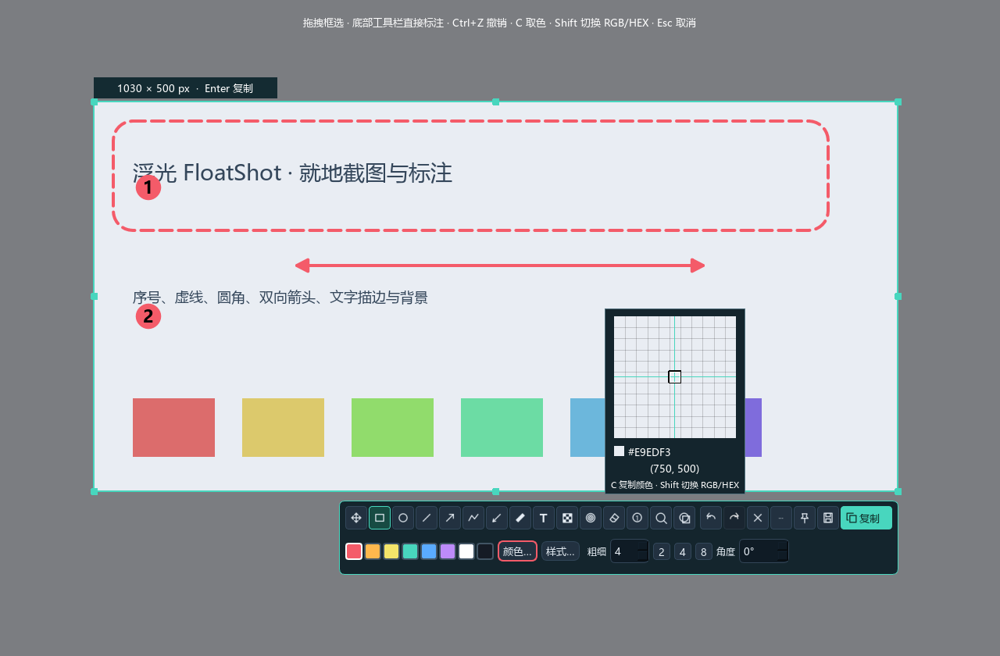
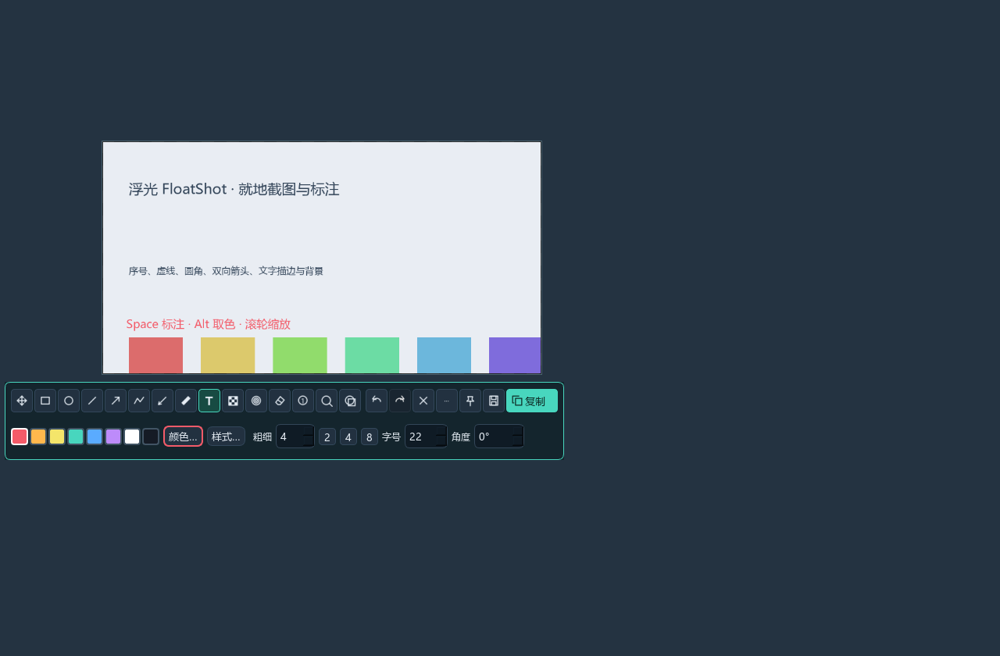

# 浮光 FloatShot v0.3：Snipaste 功能与操作对齐

> 本文为 v0.3 归档。当前截图工具栏、笔尖和标注操作请看 [v0.4 功能说明](Snipaste功能对齐-v0.4.md)。

日期：2026-10-07。平台：Windows 10/11 x64，Qt 6 Widgets / PySide6。

本项目的截图、标注、贴图以 Snipaste 的免费版和专业版操作为目标；录屏保持原有流程。此版本补齐了大部分常用交互与标注能力，**仍不等同于 Snipaste 的完整专业版**。下面按官方功能表列出实际状态，部分实现及未实现项明确标注。

## 运行位置

可执行文件：

```text
D:\UserFiles\Documents\ChatGPT\New project\dist\FloatShot-0.3.0\FloatShot.exe
```

ZIP：`dist/FloatShot-0.3.0-win-x64.zip`。解压后保留整个目录及 `_internal`。更新时先在旧版托盘中选择“退出”，再启动新版；用户设置与历史继续使用原数据目录。

## 操作方式

### 全局入口

| 操作 | 默认方式 |
| --- | --- |
| 截图 | F1 / 托盘左键 |
| 从剪贴板贴图 | F3 / 托盘中键 |
| 隐藏、显示贴图 | Shift+F3 |
| 切换鼠标下贴图穿透；没有贴图时解除全部穿透 | Ctrl+Alt+T |
| 打开工作台 | 托盘双击 |
| 区域录屏 / 暂停 / 停止 | Ctrl+Alt+R / Ctrl+Alt+P / Ctrl+Alt+S |

设置中可修改托盘单击动作、全局快捷键，添加命令快捷键及忽略程序列表。屏幕触发角与 Win+拖拽截图默认关闭，需在“鼠标与命令”中开启。右键动作设置为菜单时，可以进入设置和退出。

### 截图

F1 → 左键拖拽或单击检测区域 → 底部工具栏就地标注 → 复制、保存、贴图。截图开始前冻结桌面，导出内容来自快照。

| 操作 | 方式 |
| --- | --- |
| 复制截图 | Enter / Ctrl+C / 双击选区（选择工具状态） |
| 保存 / 快速保存 | Ctrl+S / Ctrl+Shift+S；Shift+点击保存 |
| 贴图 | Ctrl+T / 中键点击选区 |
| 取消 | Esc / 非编辑状态右键；有标注时确认，可关闭提示 |
| 正在拖拽时移动选区 | 按住 Space，移动鼠标；松开 Space 继续框选 |
| 调整选区 | 八个控制点；选择工具下拖动内部 |
| 微调选区 | 方向键移动；Ctrl+方向键扩大；Shift+方向键缩小 |
| 光标逐物理像素移动 | W / A / S / D |
| 输入尺寸、固定比例、圆角 | 点击选区尺寸标签，或“更多”菜单 |
| 上次选区 / 历史回放 | R / `,` 与 `.` |
| 刷新桌面 | F5，保留当前标注 |
| 白板、透明画板、恢复桌面 | “更多 → 画板” |
| 取色 | C 复制；Shift 切换 RGB/HEX；Alt 召唤放大镜 |
| 文字识别、扫码、输出边框阴影、发送到应用 | “更多”菜单 |

激活其他程序窗口时退出截图可在设置中关闭。手动保存取消后返回原选区。延时、截图包含鼠标、放大镜网格与取样范围、取消截图也保存历史均在设置中配置。

**DPI 差异：** W/A/S/D 已使用 Windows 物理坐标移动光标；选区边界仍以 Qt 逻辑整数坐标表示。尺寸对话框提供 px/dip 换算，非整数缩放时会四舍五入，高 DPI 下选区微调尚未达到逐物理像素精度。

### 标注

截图选区及贴图使用同一套底部工具栏，不打开独立的贴图标注窗口。工具包括矩形、椭圆、直线、箭头、折线、画笔、高亮、文字、马赛克、模糊、擦除、序号、放大镜标注，以及自由选中对象。

| 操作 | 方式 |
| --- | --- |
| 调整粗细 / 文字字号 | 滚轮或 1/2；工具栏数值框 |
| 切换直线与箭头 | Tab |
| 折线 / 单条直线 | 逐点单击 / 选折线后拖拽；Enter 或右键完成 |
| 约束形状、线条 | Shift：正方形、圆、水平/垂直/45° |
| 输入文字 | 选择文字工具后单击；Ctrl+Enter 完成；Esc 取消输入 |
| 再编辑文字内容 | 双击已完成文字 |
| 选择、移动完成的标注 | 选相同工具后拖动；“自由选中”可选择其他类型 |
| 缩放、旋转文字或形状 | 选中后拖四角、小圆点；也可用角度输入框 |
| 恢复水平文字 | 按 Shift 拖文字四角 |
| 删除 / 克隆 | Delete / Ctrl+拖动 |
| 复制 / 粘贴标注对象 | Ctrl+Shift+C / Ctrl+Shift+V |
| 撤销 / 重做 | Ctrl+Z / Ctrl+Y / Ctrl+Shift+Z |
| 自定义颜色与透明度 | “颜色…”；色板按钮上滚轮调 Alpha |
| 调色板排序、导入导出 | 拖色块排序；“样式…”内导入导出 JSON 色板 |
| 多笔尖 | 工具栏快捷笔尖；“样式…”设置 1–5 个尺寸 |

“样式…”提供虚线/点线、矩形圆角、正向/反向/双向箭头、三种箭头头部、高亮/擦除/像素处理的矩形或椭圆形状、文字背景、描边、序号起点和标注放大倍数。不同工具分别记忆参数。

选中框、手柄、鼠标取色放大镜及工具栏不进入导出图。贴图重启恢复时保留原图和完成的标注对象，可继续选择、移动或删除；撤销历史仅在当前运行期间保留。普通 PNG/JPEG/WebP 导出是位图。

### 贴图

| 操作 | 方式 |
| --- | --- |
| 移动 / 吸附其他贴图 | 拖动 / Shift+拖动 |
| 缩放 | 滚轮、+/-、拖边缘；右键输入尺寸或比例 |
| 透明度 | Ctrl+滚轮、Ctrl+ +/-；支持多选批量调整 |
| 旋转 / 水平、垂直镜像 / 灰度 | 1、2 / 3、4 / 5 |
| 恢复 100% 大小及不透明 | 中键单击，同时退出缩略图 |
| 就地标注 / 完成标注 | Space / Space |
| 固定缩略图 / 自由区域缩略图 | Shift+双击 / 右键框选区域 |
| 裁剪 | 右键“裁剪贴图”，再左键框选；Esc 取消 |
| 多选 | Ctrl+点击贴图；随后拖动或调透明度 |
| Solo | 右键“Solo”，再次选择恢复其他贴图 |
| 关闭，可恢复 | Esc / 双击 / Ctrl+W；F3 或托盘恢复 |
| 永久销毁该贴图 | Shift+Esc / 右键销毁 |
| 放大镜 / 取色 | Alt / 放大镜显示时 C；Shift 切换颜色格式 |
| 反色、置顶开关、背景、分组、颜色卡片、OCR/扫码 | 右键菜单 |

F3 支持图片、图片文件、纯文字、HTML、HEX/RGB 颜色。复制图片文件后第一次贴图显示图片，再次贴图可显示路径文字；非图像文件显示路径文字。相同剪贴板内容有已关闭贴图时优先恢复，默认保留 1 张可恢复贴图。网页图片支持剪贴板图片、图片 URL/HTML 图片来源，以及拖入已有贴图；下载失败时提示，不依赖云端图像处理。

背景提供透明、伪透明、暗色棋盘、亮色棋盘。透明模式使用 Alpha 输入区域，透明部分不可点击；伪透明模式可拖动透明部分。开启标注时恢复完整输入区域，方便绘图。

托盘“贴图分组”用于切换、新建和管理。管理可拖动排序、重命名和删除分组；删除分组将贴图移入默认分组。关闭与隐藏分别保存，Solo 不销毁其他贴图。裁剪、旋转/镜像、在灰度或缩略图上开始标注会生成新的原图，已有对象在这些变换时可能被合并为位图。

## Snipaste 官方功能对照

“已实现”表示代码提供入口和基本行为，不代表全部系统、软件和设备组合都验收完成。

### 截图

| 官方功能 | 本版状态 |
| --- | --- |
| 自由矩形、窗口检测、界面元素检测 | 已实现 Win32 和当前活动窗口 UI Automation；自绘/受保护窗口需手动框选 |
| 延时截图、自定义尺寸、白板、光标图案 | 已实现 |
| 上次区域、精确光标移动、截图历史 | 已实现；光标为物理像素，选区为逻辑坐标 |
| 自动保存、快速保存 | 已实现 |
| OCR、二维码/条形码 | 已实现本地识别；OCR 使用已安装的 Windows 语言 |
| 超级截图 | 已实现可选 Win+拖拽后复制；尚未实桌面验收，不包含 Snipaste 的完整手势配置 |
| 圆角、输入尺寸、px/dip、固定比例、透明白板 | 已实现；px/dip 换算有取整差异 |
| 父子元素检测 | 部分实现：滚轮切换包含鼠标的检测矩形；UIA 限当前活动窗口、遍历限时/数量，不是完整树选择 |
| 刷新截图、活动窗口截图 | 已实现 F5、`snip --active` 命令 |
| 带阴影/边框保存 | 已实现自绘边框与阴影，不是应用原生窗口阴影提取 |
| 原生分享 | 未实现 Windows 原生分享面板 |
| Listary 协同 | 保存时隐藏截图浮层已实现；未单独验收 Listary |
| 自定义命令发送到其他应用 | 已实现，可配置程序及 `%file%` 参数 |

### 贴图

| 官方功能 | 本版状态 |
| --- | --- |
| 剪贴板文字/图片/文件、尺寸/透明度、旋转/镜像 | 已实现 |
| 固定缩略图、自由区域缩略图、裁剪 | 已实现 |
| 分组、组管理、置顶开关 | 已实现 |
| 灰度、反色、Solo、多选 | 已实现；多选批量移动/透明度，其他批量操作待扩展 |
| 虚拟桌面支持 | 未实现独立桌面归属管理及跨桌面跟随 |
| 透明/伪透明/棋盘背景 | 已实现；输入区域使用 Qt/Windows Alpha Mask |
| 网页图片粘贴/拖拽 | 已实现图片、URL、HTML 来源；带登录/Cookie保护的地址可能失败 |
| 输入尺寸/比例、可编辑颜色卡片 | 已实现 |

### 标注

| 官方功能 | 本版状态 |
| --- | --- |
| 矩形/椭圆、线/折线/箭头、画笔、高亮、马赛克/模糊、文字、擦除 | 已实现 |
| 序号、放大镜、圆角、虚线/点线 | 已实现 |
| 高亮/马赛克/模糊/擦除的矩形与椭圆形状 | 已实现 |
| 双向/反向箭头、更多头部样式 | 已实现实心/开放/圆点；样式数量与 Snipaste 不完全一致 |
| 文字背景、描边颜色和宽度 | 已实现 |
| 图形旋转 | 部分实现：文字、矩形/椭圆及笔画工具；马赛克/模糊旋转尚未实现 |
| 二次编辑、自由选中、对象克隆/复制/删除 | 已实现；尺寸编辑以整体缩放为主，没有逐顶点编辑 |
| 1–5 个笔尖、颜色拖动排序、滚轮 Alpha、独立颜色记忆、自定义共享色板 | 已实现 |

### 其他与定制

| 官方功能 | 本版状态 |
| --- | --- |
| 屏幕触发角、复制为图片文件 | 已实现 |
| 丰富命令行、功能快捷键、忽略程序 | 已实现本项目命令集；不是 Snipaste 命令参数的全量兼容实现 |
| 放大镜网格/倍数/关闭 | 已实现取样范围、网格、自动显示开关；贴图放大镜样式暂为固定配置 |
| 托盘鼠标动作 | 已实现单击左/中/右键配置；双击固定打开工作台 |
| 主题色跟随系统 | 未实现，当前使用项目固定主题 |
| 保存未成功截图历史 | 已实现，可选 |
| 授权/付费机制 | 不复制 Snipaste 的授权、账号或商店购买流程 |

## 录屏

区域/单屏录制 → 原准备窗口 → 原倒计时 → 原浮动控制条 → 暂停/继续/停止 → MP4 预览、另存、复制视频文件。帧率、画质、系统声、麦克风、独立静音、鼠标指针、声音探测保持原实现。此版本没有修改 `recorder.py`，新增截图快捷操作在录屏选区中被隔离。

## 命令示例

```powershell
.\FloatShot.exe --command "snip"
.\FloatShot.exe --command "snip --last -o clipboard"
.\FloatShot.exe --command "snip --active -o pin"
.\FloatShot.exe --command "snip --region 100 100 800 600 -o file"
.\FloatShot.exe --command "snip --full --delay 2 -o clipboard"
.\FloatShot.exe --command "snip --last --send 0"
.\FloatShot.exe --command "paste"
.\FloatShot.exe --command "toggle"
```

`--region` 使用桌面逻辑坐标。`--file` 指定图片文件路径，路径含空格时在命令字符串内正确加引号。`--group` 选择贴图组。已运行时命令发送给本应用单实例。快捷键命令采用同一格式。支持 `home`、`history`、`settings`、`restore` 和 `through`。命令集专用于截图贴图，录屏按既有快捷键操作。

## 验证和待验收

本版包含交互、标注渲染、贴图持久化、命令、网页图片异步读取和录屏回归测试。源码测试及便携包专项结果记录于 [v0.3 更新与验证](更新记录-v0.3.0.md)。预览使用合成画面，不含真实桌面资料。





当前 Windows 会话处于锁屏状态，已验证 Qt 绘制和本地接口，尚未完成解锁桌面的实际合成显示、Win+拖拽、触发角、跨屏吸附和多种 DPI 的人工验收。上述未实现项保留在对照中，后续继续按 Snipaste 功能目标推进。

参考：Snipaste 官方 [基础操作](https://docs.snipaste.com/zh-cn/getting-started)、[高级技巧](https://docs.snipaste.com/zh-cn/advanced-tips)、[专业版对照](https://docs.snipaste.com/zh-cn/pro)。原始参考快照在 `docs/references/`，原产品规划在 [功能文档 v0.1](截图贴图录屏工具-功能文档-v0.1.md)。
