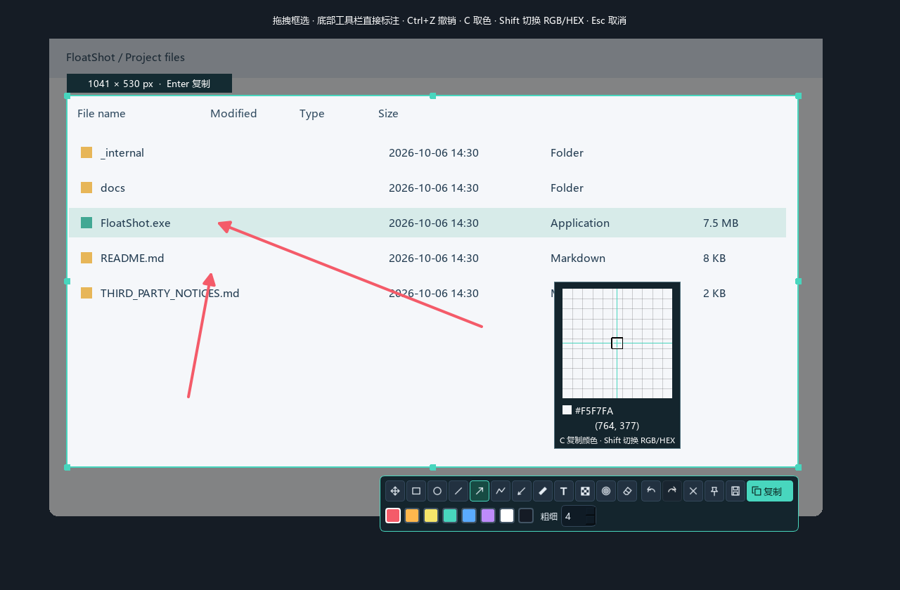
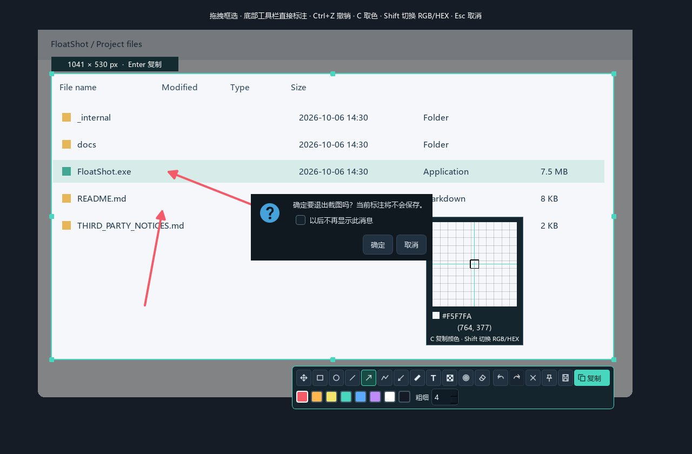

# 浮光 FloatShot：功能与操作说明

> 本文为 v0.2.0 归档说明。当前功能、快捷操作、已实现/未实现对照请看 [Snipaste 功能对齐 v0.4](Snipaste功能对齐-v0.4.md)。

适用版本：v0.2.0（Windows）  
整理日期：2026-10-06  
主要参考：Snipaste 官方基础操作、高级技巧、专业版对照，以及用户提供的两张截图。

本文既是当前版本的使用说明，也是后续统一交互的依据。“已支持”按当前代码和验证结果填写；“待补齐”是建议的开发目标。录屏是浮光的新增模块，操作由本项目定义。Snipaste 专业版完整功能清单沿用原[功能规划](截图贴图录屏工具-功能文档-v0.1.md)。

## 1. 整体使用方式

日常操作以快捷键和桌面浮层为入口：**F1 截图 → 框选 → 就地标注 → 复制／保存／贴图**。需要把参考内容留在屏幕上时，按 **F3** 从剪贴板创建贴图。录制操作过程时，按 **Ctrl+Alt+R** 开始区域录屏。

主窗口用于查看历史、调整设置和进入录屏；截图标注通过选区底部工具栏完成。当前重新打开历史图片或给已有贴图标注，仍使用独立图片编辑器。

### 推荐的交互原则

| 原则 | 对应操作 |
| --- | --- |
| 在截图位置完成任务 | 框选后直接显示工具栏，绘图、文字、撤销、输出都在当前截图流程中完成 |
| 截图、贴图共用操作习惯 | 复制、保存、取色、放大镜、标注工具尽量保持相同含义 |
| 操作取决于当前状态 | 文字输入时 Esc 取消输入，未完成图案时 Esc 取消图案，已有标注时退出提示确认 |
| 防止误丢内容 | 取消保存返回截图；关闭贴图可恢复；销毁贴图与暂时隐藏有独立入口 |
| 用鼠标发现、用键盘加速 | 图标悬停显示名称和快捷键；不记快捷键也能完成常用操作 |
| 少占用全局快捷键 | 高频入口使用全局快捷键；编辑动作只在截图／贴图界面生效 |

## 2. 全局入口

以下快捷键可在“设置 → 全局快捷键”修改。注册冲突会提示，工作台和托盘仍可调用功能。

| 操作 | 默认方式 | 当前行为 |
| --- | --- | --- |
| 开始截图 | F1 | 冻结桌面，进入区域选择 |
| 从剪贴板贴图 | F3 | 优先创建剪贴板贴图；无可贴内容时尝试恢复最近关闭的贴图 |
| 隐藏／显示全部贴图 | Shift+F3 | 切换未关闭贴图的显示状态 |
| 切换鼠标穿透 | Ctrl+Alt+T | 切换鼠标下贴图的穿透；鼠标下没有贴图时解除全部穿透 |
| 区域录屏 | Ctrl+Alt+R | 进入框选；已在录制时定位录屏控制条 |
| 暂停／继续录屏 | Ctrl+Alt+P | 切换录制状态 |
| 停止录屏 | Ctrl+Alt+S | 停止并保存；倒计时或等待开始时取消本次录制 |
| 打开工作台 | 双击托盘图标 | 显示主窗口 |
| 退出应用 | 托盘菜单“退出” | 退出常驻进程；正在录制时先停止并等待保存 |

**关闭主窗口会收起到托盘。** 更新版本时应先从托盘退出旧进程，再启动新版。

## 3. 截图与选区

### 3.1 从开始到完成

1. 按 F1，屏幕进入截图状态。
2. 左键拖动框选区域；鼠标指向可检测的窗口／控件时，单击可直接选择。
3. 松开鼠标，选区保持原亮度，外部变暗，边缘显示控制点，底部显示工具栏。
4. 直接复制，或选择工具进行标注。
5. 点击复制、保存或贴图，完成本次截图。

窗口／控件检测目前基于 Win32 子窗口，浏览器网页元素及部分自绘应用需要手动框选。截图支持多屏裁切，当前选区键盘微调单位是 Qt 逻辑坐标；高 DPI 下不等同于单个物理像素。

### 3.2 调整选区

| 目的 | 当前操作 | 说明 |
| --- | --- | --- |
| 移动选区 | 选择工具栏第一个“移动／调整选区”，拖动内部 | 绘图工具启用后，内部拖动改为绘图 |
| 调整选区大小 | 拖动四角或四边中点 | 八个控制点可用 |
| 小幅移动选区 | 方向键 | 每次移动一个逻辑坐标单位 |
| 扩大选区 | Ctrl+方向键 | 当前左右键增加宽度，上下键增加高度 |
| 缩小选区 | Shift+方向键 | 当前左右键减小宽度，上下键减小高度 |
| 微调光标 | W / A / S / D | 上／左／下／右移动一个逻辑坐标单位 |
| 重复上次选区 | R | 复用本次应用运行期间最近完成的选区 |
| 回看历史截图 | `,` / `.` | 循环回放图片历史；不是视频历史 |

调整已有标注的选区会保留标注。切换历史截图或用 R 替换已有标注的选区前会提示确认；关闭退出确认设置后也会跳过这些提示。

**待补齐：** 按住空格移动正在拖拽的选区、物理像素级微调、输入尺寸、固定比例、延时截图、截图光标、白板、刷新截图。

### 3.3 放大镜与取色

鼠标移动时显示局部像素放大、光标坐标和颜色值；框选完成后仍可使用。选区内取样包括已绘制的标注，选区外取样来自截图开始时的桌面快照。鼠标位于工具栏或正在输入文字时隐藏放大镜。

| 目的 | 当前操作 |
| --- | --- |
| 查看局部像素 | 在截图界面移动鼠标 |
| 复制颜色 | C，保持当前截图打开 |
| 切换颜色格式 | Shift，在 HEX 与 RGB 间切换 |
| 将颜色留作参考 | 复制 HEX 色值后完成或退出截图，再按 F3 创建颜色卡片 |

当前 HEX 色值可直接成为颜色卡片；形如 `244, 91, 105` 的 RGB 文本尚未专门解析为颜色，按 F3 会作为文字贴出。

**待补齐：** Alt 临时召唤／隐藏放大镜、贴图上的同款放大镜与取色、RGB 颜色卡片解析、放大镜显示策略设置。

## 4. 就地标注

### 4.1 工具栏

工具栏从左到右为：**移动选区 → 矩形 → 椭圆 → 直线 → 箭头 → 折线 → 画笔 → 高亮 → 文字 → 马赛克 → 模糊 → 擦除 → 撤销 → 重做 → 取消 → 贴图 → 保存 → 复制**。

选择绘图工具后展开颜色与粗细设置；文字工具增加字号设置。工具栏优先放在选区下方，空间不足时放在上方或屏幕内。鼠标悬停图标可查看名称。

### 4.2 各工具怎么用

| 工具 | 当前操作 | 补充 |
| --- | --- | --- |
| 矩形 | 左键拖动 | Shift 约束为正方形 |
| 椭圆 | 左键拖动 | Shift 约束为圆 |
| 直线 | 左键拖动 | Shift 约束为水平、垂直或 45° |
| 箭头 | 从起点拖向终点 | Shift 约束方向，箭头位于终点 |
| 折线 | 连续单击添加点 | 右键／Enter／双击完成；完成后再次 Enter 输出截图 |
| 画笔 | 按住左键自由绘制 | 连续笔迹 |
| 高亮 | 按住左键绘制 | 当前为半透明宽笔迹 |
| 文字 | 在选区内单击 | 使用内嵌输入框；Ctrl+Enter 完成，Enter 换行，Esc 取消本次输入 |
| 马赛克 | 拖动框选要遮盖的区域 | 当前为矩形区域，粗细影响块大小 |
| 模糊 | 拖动框选要模糊的区域 | 当前为矩形区域，粗细影响模糊强度 |
| 擦除 | 在标注上拖动 | 恢复原截图像素 |

当前调色板提供八种预设颜色，使用数字框调整粗细和字号。截图内暂不支持自定义颜色、透明度或文字旋转；独立图片编辑器提供自定义颜色和文字角度。

### 4.3 撤销、重做和局部取消

| 操作 | 当前方式 |
| --- | --- |
| 撤销完成的标注 | Ctrl+Z 或工具栏“撤销” |
| 重做 | Ctrl+Y / Ctrl+Shift+Z 或工具栏“重做” |
| 取消未完成图案 | Esc；撤销按钮也可取消当前草稿 |
| 结束折线 | 右键／Enter／双击 |
| 取消文字输入 | Esc，只取消当前输入，截图保持打开 |
| 文本框中撤销／重做 | Ctrl+Z / Ctrl+Y 操作文本内容 |

当前已完成标注通过撤销／重做管理，不能点击旧标注重新移动、改字或改色。导出为普通图片，重新打开后原标注也不是可编辑对象。

**待补齐：** 滚轮及 1/2 调笔宽、Tab 切换直线／箭头、各工具独立记忆颜色与笔宽、更多 Shift 约束、自定义颜色与 Alpha、文字缩放／旋转控制点、标注对象二次编辑、序号和放大镜标注。

## 5. 输出与退出

### 5.1 截图输出

| 结果 | 当前操作 | 输出内容 |
| --- | --- | --- |
| 复制图片 | Enter / Ctrl+C / 工具栏“复制” | 带标注的图片进入剪贴板 |
| 快速复制 | 移动工具状态下双击选区 | 复制图片；绘图工具状态下双击不作为通用复制入口 |
| 保存图片 | Ctrl+S / 工具栏“保存” | 弹出保存文件对话框，PNG 或 JPEG |
| 快速保存 | Ctrl+Shift+S | 保存到设置中的截图目录，自动生成文件名 |
| 贴到屏幕 | Ctrl+T / 工具栏“贴图” | 将带标注的选区创建为置顶图片窗口 |
| 自动保存 | 设置中开启“完成截图后自动保存” | 复制或贴图时也保存一份到截图目录 |

在内嵌文字框中，Ctrl+C 复制选中的文字。正在画折线时，第一次 Enter 完成折线，第二次 Enter 才复制截图。

成功复制、保存或贴图后写入图片历史。取消文件保存会返回原选区，保留标注。导出不包含边框、工具栏、放大镜或遮罩。

**待补齐：** 截图区中键直接贴图、Shift+点击保存快速保存、WebP、文件形式复制、阴影／边框、系统分享及外部程序输出。

### 5.2 退出截图

| 当前状态 | 按 Esc 的结果 |
| --- | --- |
| 尚未标注 | 直接退出截图 |
| 正在输入文字 | 取消本次输入，保留已完成标注 |
| 存在未完成图案 | 取消草稿；再次按 Esc 进入退出流程 |
| 已有完成的标注 | 弹出确认提示：确定退出，或取消后继续编辑 |
| 已选择“不再提示” | 退出时跳过确认 |

退出提示支持“以后不再显示此消息”；只在确定退出时保存这一选择。需要恢复提示时，打开“设置 → 常规与存储 → 已有标注时，退出截图前提示确认”。

工具栏取消按钮进入同一退出确认流程。右键在折线状态下完成折线，其他状态下执行当前局部取消／退出。

## 6. 桌面贴图

### 6.1 创建贴图

| 剪贴板内容 | F3 的当前结果 |
| --- | --- |
| 图片 | 置顶显示图片 |
| 已复制的本地图片文件 | 读取图片并贴出 |
| 纯文字 | 生成文字卡片 |
| 合法 HEX 等 QColor 可识别色值 | 生成颜色卡片 |
| 无可贴内容 | 尝试恢复最近关闭的贴图 |

恢复最近关闭贴图的可靠入口是**托盘菜单“恢复最近关闭的贴图”**。当前 F3 优先处理剪贴板，剪贴板仍有图片时会创建新贴图。

### 6.2 操作贴图

以下键盘操作需当前贴图获得焦点。

| 目的 | 当前操作 |
| --- | --- |
| 移动 | 左键拖动 |
| 缩放 | 滚轮、`+` / `-`，或拖动右下角 |
| 调整透明度 | Ctrl+滚轮 |
| 左旋／右旋 90° | 1 / 2 |
| 水平／垂直镜像 | 3 / 4 |
| 恢复原尺寸和完全不透明 | 右键菜单“恢复原始大小” |
| 标注贴图 | Space / 右键“标注”；当前打开独立编辑器，完成后“应用到贴图” |
| 复制图片 | Ctrl+C / 右键菜单 |
| 保存图片 | Ctrl+S / 右键菜单 |
| 快速保存图片 | Ctrl+Shift+S |
| 鼠标穿透 | Ctrl+Alt+T / 右键菜单 |
| 解除全部穿透 | 鼠标移到无贴图处按 Ctrl+Alt+T，或使用托盘菜单 |
| 找回屏幕外贴图 | 托盘菜单“找回屏幕外贴图” |

### 6.3 隐藏、关闭与销毁

| 行为 | 方式 | 结果 |
| --- | --- | --- |
| 暂时隐藏 | Shift+F3 | 隐藏全部未关闭贴图，再按恢复显示；布局可随应用重启恢复 |
| 关闭单张 | Esc / 双击 / 右键“关闭” | 可从托盘恢复最近关闭的一张；本次运行最多保留十张已关闭贴图 |
| 恢复关闭 | 托盘“恢复最近关闭的贴图” | 恢复最后关闭的一张并解除它的鼠标穿透 |
| 销毁 | Shift+Esc / 右键“销毁贴图” | 移除这张贴图及应用管理的贴图缓存，无法从关闭队列恢复 |

关闭队列目前不跨重启保存。销毁贴图不删除原始图片文件；剪贴板仍有该图片时，F3 可创建另一张新贴图。鼠标穿透开关目前不随重启恢复，以便重启后可直接操作贴图。

**待补齐：** 中键重置、Ctrl+`+` / `-` 调透明度、Ctrl+W 关闭、完整边缘缩放、Shift 拖动吸附对齐、缩略图、贴图裁剪、就地标注、贴图分组／多选／Solo、置顶开关、RGB 卡片、HTML 与网页图片支持。

## 7. 录屏

录屏沿用“选区 → 确认 → 输出”的操作顺序。当前支持区域／单显示器整屏，MP4（H.264/AAC）、15/30 fps、最高 1080p、指针显示、系统声音与麦克风、倒计时和暂停。

1. 按 Ctrl+Alt+R，框选区域后 Enter 或点击“开始录制”。整屏录制从工作台或托盘进入。
2. 在准备窗口检查录制范围、声音设备、帧率、画质和倒计时。系统声音与麦克风首次默认关闭，之后记忆选择。
3. 点击开始，倒计时结束后录制。倒计时可取消。
4. 使用控制条或 Ctrl+Alt+P 暂停／继续，系统声音和麦克风可独立静音。
5. 按 Ctrl+Alt+S 或点击停止，等待编码与声音合成，然后查看视频预览。
6. 预览中可播放、定位、打开目录、另存或复制视频文件。

| 规则 | 当前行为 |
| --- | --- |
| 暂停 | 暂停区间从视频和音频时间轴移除 |
| 停止 | 保存有效录制内容，不是丢弃录制 |
| 保存 | 自动写入录屏目录，并加入视频历史 |
| Esc | 不作为正在录制时的停止快捷键 |
| 范围 | 区域必须位于一个显示器内 |
| 同时截图 | 当前录制期间不启动截图 |
| 画面中的贴图 | 录屏区域内可见贴图会被录入 |
| 锁屏／会话断开／休眠／显示器移除 | 尝试停止并保存已录片段 |

**待补齐：** 窗口跟随录制、GIF、首尾裁剪、录制中标注、摄像头、4K/60 fps，以及更完整的异常恢复入口。

## 8. 历史与设置

| 功能 | 当前操作／结果 |
| --- | --- |
| 最近捕获 | 工作台显示最近记录，双击打开 |
| 图片历史 | 打开后可在图片编辑器新增标注、输出或贴图 |
| 视频历史 | 打开预览，可复制视频文件 |
| 移除历史 | 删除记录及受管理的缓存，保留用户另存的图片／视频 |
| 缓存上限 | 设置历史数量与图片缓存容量 |
| 输出位置 | 设置截图、录屏目录 |
| 退出确认 | 可重新开启已有标注时的退出提示 |
| 贴图布局 | 设置启动时恢复未关闭贴图及布局 |
| 开机启动 | 可选常驻托盘 |
| 快捷键 | 调整全局快捷键，检测冲突 |

默认输出位置为 Windows 文档目录下的 `FloatShot/截图` 和 `FloatShot/录屏`。设置、缓存、贴图与日志所在目录可在设置窗口查看。

## 9. 与 Snipaste 的对照及补齐顺序

### 9.1 已有相近操作

| Snipaste 操作习惯 | 浮光 v0.2.0 状态 |
| --- | --- |
| F1 截图，F3 贴图，Shift+F3 隐藏全部 | 已支持；贴图恢复优先级有差异 |
| 框选后底部工具栏直接标注 | 已支持 |
| 局部放大、C 取色、Shift 切颜色格式 | 截图已支持；贴图未支持 |
| Enter / Ctrl+C 复制，Ctrl+S 保存，Ctrl+T 贴图 | 已支持 |
| Ctrl+Shift+S 快速保存 | 已支持 |
| 箭头、形状、画笔、高亮、文字及遮盖 | 已支持基础工具；参数与绘制模式尚未完整对齐 |
| 键盘微调、历史回放 | 已支持逻辑坐标版本 |
| 滚轮缩放、Ctrl+滚轮透明度、1/2 旋转、3/4 镜像 | 已支持 |
| 关闭可恢复、隐藏与销毁分开 | 已支持；恢复队列规则有差异 |
| 鼠标穿透、重启恢复布局 | 已支持基础行为 |

### 9.2 下一步优先补齐

优先把日常操作做顺，再扩展专业能力。以下是建议顺序，尚未全部实现。

| 优先级 | 功能与操作 | 完成标准 |
| --- | --- | --- |
| P0 | 标注滚轮／1/2 调笔宽、Tab 切换直线／箭头 | 当前绘图工具中生效；不干扰文字输入和选区调整 |
| P0 | 中键贴图、中键重置、Shift+点击保存、Ctrl+W 关闭贴图 | 鼠标和键盘入口结果一致 |
| P0 | Alt 放大镜、贴图取色、RGB 卡片解析 | 截图和贴图拥有一致的取样及颜色操作 |
| P0 | 按住空格移动正在框选的区域 | 保持鼠标按下即可从调整大小切换为移动 |
| P0 | 贴图就地标注 | Space 在贴图附近展开同款工具栏，完成后保留原位置 |
| P1 | 自定义颜色／Alpha、各工具参数记忆 | 工具切换保留自己的颜色和粗细 |
| P1 | 物理像素微调、尺寸输入、固定比例 | 混合 DPI 下显示尺寸与导出一致 |
| P1 | 标注对象二次编辑、序号、文字旋转 | 已完成对象可选中、移动和修改，撤销记录完整 |
| P1 | 贴图裁剪、缩略图、吸附、分组 | 暂存、恢复、显示状态有清晰规则 |
| P1 | OCR／扫码、GIF／视频裁剪 | 形成截图内容提取与短录屏输出流程 |
| P2 | 更全面的元素检测、父子元素选择 | 常用应用的检测行为经过实际验证 |
| P2 | 多选／Solo、虚拟桌面、外部输出、录屏进阶 | 按专业版功能规划逐项验收 |

其中贴图分组、固定尺寸缩略图、延时截图、白板等在官方对照中属于 Snipaste 免费版基础能力；OCR、扫码、贴图裁剪、序号标注、标注二次编辑等属于专业版能力。当前仍缺少部分基础交互，不能把所有待补齐功能都称作“付费功能”。

## 10. 资料依据与验证范围

- [Snipaste 基础操作](https://docs.snipaste.com/zh-cn/getting-started)：截图／标注／贴图的默认操作；[本地快照](references/getting-started-zh.md)。
- [Snipaste 高级技巧](https://docs.snipaste.com/zh-cn/advanced-tips)：Shift 约束、空间键移动选区、吸附等；[本地快照](references/advanced-tips-zh.md)。
- [Snipaste 专业版对照](https://docs.snipaste.com/zh-cn/pro)：免费／专业版功能边界；[本地快照](references/pro-zh.md)。
- 用户参考图：已有标注时的退出提示、选中后放大镜、底部快速标注。
- 当前实现依据：`capture.py`、`capture_ui.py`、`editor.py`、`pins.py`、`app.py`、`dialogs.py`、`storage.py`。

官方资料使用本项目 2026-10-06 留存的快照；不同平台、版本或用户自定义设置可能改变 Snipaste 的默认行为。本文以 Windows 操作习惯为参考，不表示完整兼容所有 Snipaste 行为。

v0.2.0 已有 31 项自动化测试通过；检查了选区内标注、高 DPI 导出、取色、退出确认、保存取消恢复和其他基础流程。真实桌面合成画面的显示、长录制及更多硬件环境仍需实际验收。
