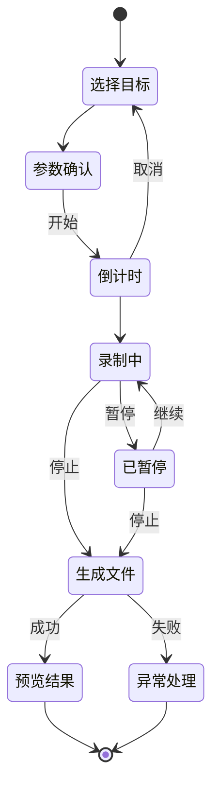

# 截图、贴图与录屏工具：功能文档

> 本文是原始功能规划，包含尚未实现的功能与建议。当前 v0.2.0 的真实操作方式、功能状态及 Snipaste 对照，以 [功能与操作说明](功能与操作说明-Snipaste对标.md) 为准。

版本：v0.1，功能评审稿  
整理及官方资料核查日期：2026-10-06  
对标产品：Snipaste 2  
项目名称：待定  
首发平台建议：Windows 10 / 11，64 位桌面端

> 产品目标：保留 Snipaste 快速截图、标注、桌面贴图的工作方式，逐步覆盖其专业版能力，并加入能录制画面、系统声音和麦克风的录屏功能。
>
> 本文中的 Snipaste 功能和授权信息来自官方资料；开发范围、优先级、录屏规格和验收指标是本项目的建议方案，尚未经过实现验证。本文先用于评审，不锁定技术栈和开发周期。

## 1. 产品定位与典型场景

一款常驻系统托盘、通过快捷键调用的桌面效率工具。主要操作围绕“选中屏幕内容 → 标注或识别 → 复制、保存、贴图或录制”展开。

| 用户与场景 | 需要完成的事情 | 对应能力 |
| --- | --- | --- |
| 开发、测试、客服 | 截取报错，标注问题，录制复现步骤 | 截图、标注、录屏、系统声音 |
| 设计、前端 | 将参考图置顶，与当前界面对比 | 贴图、透明度、取色、像素测量 |
| 教学、培训 | 录制操作讲解，强调鼠标与按键 | 麦克风、点击提示、录制中标注 |
| 日常办公 | 临时贴出文字、图片、颜色，复制图片中的文字 | 文字贴图、颜色卡片、OCR |
| 资料整理 | 保存截图与视频，恢复之前的贴图布局 | 历史记录、贴图分组、自动恢复 |

体验要求：快捷键调用迅速；常用操作直接完成；图片和视频默认保存在本地；截图、贴图、录屏使用一致的选区和输出习惯。

## 2. 范围及事实边界

| 内容 | 本文处理方式 |
| --- | --- |
| Snipaste 免费版功能 | 作为复刻的基础能力，见第 3 节 |
| Snipaste 专业版功能 | 按官方对比表逐项整理，共 54 个新增或增强对比项，见第 4 节 |
| 对比表之外的专业版细节 | 根据官方特性说明与更新日志补充，不将历史修复重复计算为新功能 |
| 视频录屏、GIF 录制 | 本项目新增能力；已查阅的官方功能对比表和更新日志未将其列为 Snipaste 已发布功能 |
| 滚动长截图 | 本项目可选扩展；不标为 Snipaste 已有专业版功能 |
| 本项目是否收费 | 待定。原产品的付费划分仅用于对标，不自动成为本项目的收费划分 |
| 平台 | 先按 Windows 10/11 设计；macOS、Linux 后续独立验证和适配 |
| 复刻深度 | 自研实现相同类别的功能和操作体验；产品名称、图标与视觉另行设计 |

官方 FAQ 仍将“滚动截图 / GIF 录制”指向需求追踪页，因此本文对其采用“未在已核查发布资料中确认”的表述。[S4]

优先级定义：

- **P0：首个可用版本。** 完成截图、标注、贴图和基础录屏的完整使用流程。
- **P1：优先补齐。** 日常价值较高的专业版能力及录屏增强。
- **P2：完整对标与扩展。** 进阶编辑、自动化、外部集成及高规格录制。
- **P3：跨平台。** macOS、Linux 的平台适配与差异验收。

## 3. Snipaste 原有基础功能

以下基础归属参考官方首页、免费版/专业版对比表和基础操作说明。[S1][S2][S5]

| 编号 | 模块 | 功能 | 本项目建议 |
| --- | --- | --- | --- |
| B01 | 截图 | 自由矩形区域、窗口检测、界面元素检测 | P0；先覆盖常见系统窗口及可检测控件 |
| B02 | 截图 | 多显示器、高 DPI 支持 | P0；包括不同缩放比例的双屏 |
| B03 | 截图 | 光标放大镜、像素级光标与选区调整 | P0 |
| B04 | 截图 | RGB / HEX 取色，颜色格式切换 | P0 |
| B05 | 截图 | 延时截图 | P1 |
| B06 | 截图 | 开始截图前设置自定义尺寸 | P1；与专业版“截图过程中输入尺寸”区分 |
| B07 | 截图 | 捕捉光标图案 | P1；可开关 |
| B08 | 截图 | 重复上一次截图区域 | P0 |
| B09 | 截图 | 白板模式 | P1；基础版为非透明白板 |
| B10 | 截图 | 截图历史回放 | P0；默认记录完成复制、保存或贴出的截图 |
| B11 | 输出 | 复制图片、保存文件、快速保存、自动保存 | P0；自动保存默认关闭 |
| B12 | 贴图 | 剪贴板图片转换为桌面置顶窗口 | P0 |
| B13 | 贴图 | 纯文本、HTML 文本、颜色信息转换为图片贴出 | P1 |
| B14 | 贴图 | 从图片文件创建贴图；非图片文件可将路径贴出 | P1 |
| B15 | 贴图 | 拖动、缩放、透明度、旋转、水平/垂直镜像 | P0 |
| B16 | 贴图 | 鼠标穿透 | P0；提供统一解除入口 |
| B17 | 贴图 | 固定尺寸缩略图 | P1 |
| B18 | 贴图 | 隐藏、恢复、关闭、销毁 | P0；各状态规则见第 8 节 |
| B19 | 贴图 | 基础贴图分组 | P1；高级组管理属于专业版增强 |
| B20 | 贴图 | 自动备份和恢复 | P0；首版恢复图片、位置、大小和透明度 |
| B21 | 贴图 | GIF 文件贴图，播放速度及逐帧查看 | P2；这是显示已有 GIF，不是录制 GIF |
| B22 | 标注 | 矩形、椭圆、直线、折线、箭头、画笔、记号笔 | P0 |
| B23 | 标注 | 文本、马赛克、高斯模糊、橡皮擦 | P0 |
| B24 | 标注 | 撤销/重做、颜色、粗细、透明度 | P0 |
| B25 | 标注 | 在贴图上进入标注；基础文字旋转 | P0 |
| B26 | 设置 | 常用全局快捷键、托盘、开机启动、主题色及功能选项 | P0 |

注意两个容易混淆的归属：

- 免费版已有窗口检测，但“通过命令直接截取活动窗口”列在专业版。
- 免费版已有贴图分组，但集中添加、删除、重命名、排序等“贴图组管理”列在专业版。

## 4. Snipaste 付费功能完整对照

### 4.1 截图与识别：15 项

本节各项在官方对比表中均为“免费版无、专业版有”。优先级为本项目建议。[S2]

| 编号 | 专业版功能 | 功能说明 | 优先级 |
| --- | --- | --- | --- |
| PRO-01 | 文字识别 | 从截图识别文字；官方 v2.11 加入 OCR | P1 |
| PRO-02 | 识别二维码/条形码 | 解码截图中的二维码、条形码 | P1 |
| PRO-03 | 超级截屏 | 使用修饰键加鼠标拖拽直接截图，如 Windows 下 Win + 拖拽 | P2 |
| PRO-04 | 圆角矩形截图 | 生成圆角选区的截图 | P1 |
| PRO-05 | 检测界面父/子元素 | 通过滚轮选择控件层级；官方注明 Linux 版不支持 | P2 |
| PRO-06 | 刷新截图 | 更新屏幕底图，保持已有标注；支持持续刷新 | P1 |
| PRO-07 | 输入截屏区域尺寸 | 进入截图后手动输入选区宽高 | P1 |
| PRO-08 | 切换截屏尺寸单位 (px/dip) | 切换物理像素和逻辑尺寸显示 | P1 |
| PRO-09 | 活动窗口截屏 | 直接截取当前活动窗口 | P1 |
| PRO-10 | 固定截图区域长宽比 | 锁定纵横比，保持比例调整选区 | P1 |
| PRO-11 | 透明白板模式 | 在透明背景上进行标注 | P2 |
| PRO-12 | 带阴影/边框保存 | 输出可附带阴影或边框，并自定义参数 | P1 |
| PRO-13 | 原生分享 (Windows 10+) | 调用 Windows 的系统分享界面 | P2 |
| PRO-14 | 配合 Listary 使用 (手动保存文件时隐藏截图窗口) | 保存时隐藏截屏界面，以配合文件定位工具 | P2 |
| PRO-15 | 发送截图到其他应用程序（通过自定义命令行参数） | 将截图交给外部编辑器、处理器等 | P2 |

### 4.2 桌面贴图：13 项

本节各项均为专业版新增。[S2]

| 编号 | 专业版功能 | 功能说明 | 优先级 |
| --- | --- | --- | --- |
| PRO-16 | 取消/启用贴图窗口置顶 | 每张贴图单独设置是否置顶 | P1 |
| PRO-17 | 自由尺寸缩略图 | 自选贴图局部作为缩略显示内容 | P1 |
| PRO-18 | 贴图裁剪 | 对贴图进行裁剪 | P1 |
| PRO-19 | 灰度转换 | 切换灰度显示 | P1 |
| PRO-20 | 反色 | 切换颜色反转 | P1 |
| PRO-21 | 支持虚拟桌面 | 将贴图固定到指定或全部虚拟桌面 | P2 |
| PRO-22 | Solo 模式 | 临时只显示指定贴图，其余贴图保留并隐藏 | P1 |
| PRO-23 | 多选贴图窗口 | 多选并批量移动、缩放、透明度调整等 | P1 |
| PRO-24 | 背景模式 (对于有透明通道的贴图) | 透明、伪透明、暗色棋盘、亮色棋盘；伪透明允许点击透明区域 | P1 |
| PRO-25 | 支持粘贴/拖拽网页图片 | 从浏览器获取网页图片；部分路径需要联网下载 | P1 |
| PRO-26 | 贴图组管理 | 集中添加、删除、重命名和排序分组 | P1 |
| PRO-27 | 输入贴图尺寸/缩放比例 | 用精确数值控制显示尺寸 | P1 |
| PRO-28 | 可编辑的颜色卡片 | 修改贴出的颜色值 | P1 |

### 4.3 标注与编辑：17 项

除注明增强的项目外，以下均为专业版新增。[S2]

| 编号 | 专业版功能 | 功能说明及免费版区别 | 优先级 |
| --- | --- | --- | --- |
| PRO-29 | 序号标注 | 自动递增的步骤编号，支持多组计数 | P1 |
| PRO-30 | 放大镜标注 | 放大图片局部并作为标注输出；区别于取色时的放大镜 | P1 |
| PRO-31 | 圆角矩形标注 | 绘制可调圆角矩形 | P1 |
| PRO-32 | 虚线/点线 (矩形/椭圆/直线/折线/箭头/画笔) | 多种线型样式 | P1 |
| PRO-33 | 记号笔/马赛克/模糊/橡皮擦 支持 椭圆/圆形 形状 | 增加椭圆及圆形作用区域 | P1 |
| PRO-34 | 双向/反向箭头 | 调整箭头端点及方向 | P1 |
| PRO-35 | 更多箭头样式 | 额外箭头造型 | P2 |
| PRO-36 | 文字背景填充 | 为文本设置背景色 | P1 |
| PRO-37 | 自定义文字描边的颜色/宽度 | 设置文字轮廓效果 | P1 |
| PRO-38 | 旋转标注图形 | 免费版仅文字可旋转；专业版除线条标注外都支持 | P1 |
| PRO-39 | 二次编辑 | 重新选择已完成的标注，移动、改样式、复制或删除 | P1 |
| PRO-40 | 自由选中 | 在标注工具之间更自由地选择已有对象 | P1 |
| PRO-41 | 笔尖数量 | 免费版 1 个；专业版可保存 1–5 个笔尖配置 | P2 |
| PRO-42 | 拖拽调色板以重新排序颜色 | 调整常用颜色顺序 | P2 |
| PRO-43 | 滚轮调整颜色透明度 | 在颜色按钮上通过滚轮调整透明度 | P1 |
| PRO-44 | 为不同标注形状分别记忆颜色 | 每类工具保留各自颜色偏好 | P1 |
| PRO-45 | 自定义调色板，分享调色板 | 自定义、导入导出常用配色 | P2 |

### 4.4 自动化和自定义：9 项

“命令行选项”为增强项，其他项目为专业版新增。[S2]

| 编号 | 专业版功能 | 功能说明 | 优先级 |
| --- | --- | --- | --- |
| PRO-46 | 屏幕触发角 | 鼠标停留在屏幕角落时执行指定操作 | P2 |
| PRO-47 | 复制截图为文件 | 剪贴板同时包含图像和文件，可直接粘贴到文件管理器 | P1 |
| PRO-48 | 命令行选项 | 免费版基础指令；专业版扩展截图、输出、贴图、白板等指令 | P2 |
| PRO-49 | 为任意功能绑定全局快捷键 | 将任意支持的命令绑定为快捷键 | P1 |
| PRO-50 | 在指定程序忽略某全局快捷键 | 按程序配置快捷键忽略规则 | P1 |
| PRO-51 | 自定义放大镜样式 | 自定义网格、倍率等 | P2 |
| PRO-52 | 完全隐藏放大镜 | 禁用选区时的放大镜 | P1 |
| PRO-53 | 自定义托盘图标的鼠标动作 | 分别设置左、中、右键动作；官方表格原文为“托盘图图标” | P2 |
| PRO-54 | 主题色跟随系统主题 | 自动同步系统主题色 | P1 |

### 4.5 官方说明和更新日志中的补充细节

这些是上述能力的进一步规格，或未单列在对比表中的专业版选项；不与 54 个对比项重复计数。[S2][S3]

| 补充项 | 官方依据及行为 | 本项目建议 |
| --- | --- | --- |
| 保存所有截图记录 | 专业版特性说明允许记录未完成保存的截图；免费版默认仅保存成功截图 | P1；作为显式历史策略选项 |
| 自定义部分应用内快捷键 | v2.11.3；与全局快捷键设置不同 | P1 |
| OCR 服务接口 | v2.11.3 支持腾讯和 OCR.space；不据此认定所有识别都离线 | P2；本项目优先尝试本地识别 |
| 取色器显示 HSV 等色值 | v2.10.4，专业版增强 | P1 |
| 自定义输出与命令行控制 | 可绑定按键到输出；支持多输出、静默保存、`--hold`、`--block` 等 | P2；归入 PRO-15/48/49 |
| 贴图批处理与输出细节 | 批量保存；以原始大小保存已缩放贴图；自定义背景色及输出时保留背景 | P1；归入 PRO-23/24 |
| 显示或隐藏贴图标注 | v2.8；原始底图保留，标注显示可切换 | P1；归入 PRO-39 |
| 更细的标注操作 | Ctrl 拖拽克隆；中心点缩放、等比例缩放；可禁用橡皮擦二次编辑 | P1；归入 PRO-39/40 |
| 触发角与局部快捷键细节 | 触发角程序黑名单、启用开关；贴图 Esc/Shift+Esc 和选区缩略图按键可配置 | P2；归入 PRO-46/50 |
| 高级配置 | 输出选项隐藏、选区过渡动画、文件元信息、网页图片自动下载大小上限等 | P2；按实际使用价值细化 |

历史修复、同一功能在不同系统上的兼容改进、优惠及退款政策没有作为产品功能重复列入。

### 4.6 当前价格与授权机制

以下为核查日官网展示价格，购买地区及渠道页面可能调整。[S1][S2]

| 授权渠道 | 官网展示价格 | 设备范围 |
| --- | --- | --- |
| 桌面专业版，单设备 | 45 元 | 1 台 Windows / Mac / Linux 设备 |
| 桌面专业版，三设备 | 99 元 | 3 台 Windows / Mac / Linux 设备 |
| 微软商店专业版 | 99 元 | 最多 10 台 Windows 10 / 11 设备，绑定微软账号 |

- Snipaste 2 按大版本买断，可永久使用该大版本，包含子版本更新；不包含将来的 Snipaste 3。
- 桌面版与微软商店版授权互不通用。
- 桌面版支持激活、反激活、设备额度管理及离线激活；商店版通过微软账号恢复购买。
- Snipaste 2.x 免费版限个人使用；公司使用需购买授权或使用 Snipaste 1.x。
- 官方说明免费版后续主要提供缺陷修复，专业版继续新增功能。

专业版说明页仍重点描述 99 元三设备方案，单设备 45 元方案以当前官网首页为据。本项目不沿用上述价格和设备限制，是否增加授权管理待商业化方案确定。

## 5. 本项目的截图、贴图及标注规格

本节将第 3、4 节的清单转换为可评审的使用规则。

### 5.1 截图

1. 使用全局快捷键或托盘入口开始截图，冻结当前画面，显示选区与放大镜。
2. 鼠标悬停时优先框选可检测的窗口或控件；拖拽可随时改为自由选区。无法检测控件时仍可手动截图。
3. 支持键盘逐像素移动和调整范围，展示宽、高、坐标；选区跨屏时正确处理显示器坐标与 DPI。
4. 完成选区后显示标注和输出工具栏。复制、保存、贴图任一成功后结束截图并写入历史。
5. Esc 取消；取消时不覆写剪贴板。记录取消截图为 P1 可选设置，默认关闭。
6. 截图选区尺寸、工具栏位置、快捷键操作与录屏选区保持一致。
7. P1 支持延时、尺寸预设、圆角、固定纵横比、刷新底图及活动窗口快捷截图。

**输出格式建议：** 首版 PNG、JPEG；P1 加入 WebP。PNG 支持透明通道；JPEG 透明区域使用明确的背景色。复制到剪贴板的图片优先保持清晰度，不使用 JPEG 压缩作为默认行为。

### 5.2 贴图

1. 通过快捷键把剪贴板图片或当前截图贴到桌面，默认置顶；初次出现时位于可见屏幕区域。
2. 支持移动、缩放、旋转、镜像、透明度及鼠标穿透；保持原始图像，避免连续缩放损失画质。
3. 鼠标穿透开启时显示短暂状态提示；托盘和全局快捷键始终能够解除穿透。
4. 隐藏全部贴图后再次调用可恢复。Solo 模式退出后恢复此前的可见状态。
5. P1 支持批量操作、裁剪、精确尺寸、分组管理、网页图片及透明背景模式。
6. 显示器断开后，提供“找回屏幕外贴图”；恢复显示器时可恢复原布局。
7. 退出再启动时，按设置恢复贴图内容及布局。分组、标注对象等恢复能力随相应功能版本加入。

### 5.3 标注

1. 截图和贴图共用同一套基础工具。每个操作都进入撤销/重做历史。
2. 支持 Shift 约束正方形、圆形、水平/垂直/45°线条；调节颜色、粗细、透明度和文字大小。
3. P1 加入序号、圆角、放大镜标注、线型、文字背景与描边，以及对象选择和二次编辑。
4. 导出 PNG/JPEG/WebP 时将可见标注合成到图片；普通导出图片不包含可再编辑的对象结构。
5. P1 可保存本地编辑项目，保留原图和标注对象，以便下次继续编辑；该项目格式属于本项目新增的实现建议。
6. 保存时准确展示最终输出区域，边框、阴影、透明背景的效果以预览为准。

### 5.4 OCR、二维码及取色

- OCR：选区识别 → 展示结果 → 编辑、复制。P1 先支持印刷体中文和英文，保留换行；表格还原、翻译暂不纳入首批。
- 优先评估本地 OCR。若提供云端识别，用户主动选择服务，并在调用前能知道需要上传当前选区；识别失败不影响截图保存。
- 二维码/条形码：展示解码文本，可复制；URL 通过用户点击打开。
- 取色：P0 支持 HEX/RGB，P1 加 HSV、可编辑颜色卡片；颜色值随格式切换可直接复制。

## 6. 新增录屏功能

录屏是本项目新增模块，以下规格属于产品建议，不是 Snipaste 专业版现状。

### 6.1 录屏功能清单

| 编号 | 功能 | 行为与边界 | 优先级 |
| --- | --- | --- | --- |
| REC-01 | 区域录屏 | 使用截图式框选，自由调整范围；开始后锁定区域 | P0 |
| REC-02 | 单显示器全屏录制 | 选择一个显示器；支持不同 DPI | P0 |
| REC-03 | 指定窗口录制 | 绑定窗口，移动窗口后继续录制其内容 | P1 |
| REC-04 | 录制参数 | 默认 30 fps；输出不超过 1080p，不放大低分辨率源；提供画质预设 | P0 |
| REC-05 | 倒计时 | 默认 3 秒，可改为立即开始 | P0 |
| REC-06 | 系统声音 | 独立开关，录制当前所选输出设备的声音 | P0 |
| REC-07 | 麦克风 | 独立开关及设备选择；支持与系统声音同时录制 | P0 |
| REC-08 | 音量显示与静音 | 录制前显示输入电平；录制中可独立静音两类声音 | P0 |
| REC-09 | 暂停/继续/停止 | 浮动控制条和快捷键操作；暂停时间不计入成片 | P0 |
| REC-10 | 光标开关 | 可选择录入鼠标指针 | P0 |
| REC-11 | 点击及按键提示 | 显示点击光圈、鼠标高亮、快捷键组合 | P1 |
| REC-12 | MP4 导出 | H.264 视频；有音频时使用 AAC；默认无水印 | P0 |
| REC-13 | 结果预览 | 播放、定位文件、另存为、复制文件、重新录制 | P0 |
| REC-14 | 录屏历史 | 展示缩略图、时长、尺寸、文件大小及所在目录 | P0 |
| REC-15 | 首尾裁剪 | 在预览中设置开始、结束时间并导出副本 | P1 |
| REC-16 | GIF 录制/导出 | 适合短演示，可设置帧率和尺寸；GIF 不包含声音 | P1 |
| REC-17 | 录制中标注 | 实时画笔、箭头、文字，支持清空；最终烧录进画面 | P1 |
| REC-18 | 贴图与录屏联动 | 可将贴图作为参考或水印；明确选择是否纳入成片 | P1 |
| REC-19 | 摄像头画中画 | 摄像头选择、位置、大小与边框设置 | P2 |
| REC-20 | 定时停止 | 按指定时长自动结束，显示剩余时间 | P1 |
| REC-21 | 高规格录制 | 原生 4K、60 fps、硬件编码及高级码率设置 | P2 |
| REC-22 | 多显示器合并录制 | 统一输出画布；不同尺寸及缩放比例分别处理 | P2 |
| REC-23 | 异常恢复 | 启动时发现可恢复的录制片段，提示恢复为视频 | P1 |
| REC-24 | 视频抽帧贴图 | 在预览中取当前帧，转成截图进行标注或贴出 | P1 |

本项目建议基础录屏无水印、不人为限制时长；实际录制仍受磁盘空间和设备性能影响。是否将增强能力设为付费，另行决定。

### 6.2 录制流程与状态

1. 快捷键打开选区，选择区域或显示器；P1 增加窗口目标。
2. 确认声音来源、麦克风、光标、画质和目录。保持上次设置，界面明确展示是否有声音。
3. 倒计时完成后开始，显示范围提示、已录时长、音频状态、暂停和停止按钮。
4. 停止后先生成可播放文件，再进入结果预览；保留原始视频，后续裁剪生成副本。

同一时间只允许一个录制任务。录制中触发录屏入口时，定位到已有控制条，不创建第二个任务。

### 6.3 关键行为

| 情况 | 约定行为 |
| --- | --- |
| 暂停录制 | 画面和音频同时暂停；成片时间轴移除暂停区间 |
| 录制中修改选区 | 首版不支持；停止后重新框选 |
| 区域内窗口移动 | 区域录制仍录固定屏幕坐标，不跟随窗口 |
| 指定窗口移动或调整大小 | P1 随窗口移动；输出画布尺寸保持不变，内容等比适配并补边 |
| 指定窗口最小化或关闭 | P1 暂停并提示；关闭后可停止保存，不静默生成黑屏片段 |
| 音频设备不存在或无权限 | 开始前提示，允许改设备或选择无该音轨继续 |
| 录制中音频设备断开 | 保留已录内容，提示设备失效；对应音轨变为静音，画面继续 |
| 显示器断开、锁屏或休眠 | 结束录制并尽可能保存已录内容；结果注明中断原因 |
| 保存目录失效或磁盘空间不足 | 开始前检查；录制中检测到问题则结束并保留已完成内容，提供改目录保存入口 |
| 编码器或硬件编码不可用 | 使用可用的兼容编码路径；无法满足时在开始前给出可选方案 |
| 控制条和选区边框 | 默认不录入成片；需要验证平台排除能力，不可靠时移出选区 |
| 贴图是否被录入 | 首版录制屏幕实际画面，选区内可见贴图会被录入；P1 提供显式纳入/排除设置 |
| 按键提示 | 默认关闭；开启时只显示配置的快捷键组合，不记录普通文字输入 |
| 录制中截图 | P0 暂不同时启动截图，提示当前正在录制；P1 通过视频抽帧满足需求 |
| 受系统限制的画面 | 不承诺捕获被系统保护的内容；在实际支持范围说明中标明表现 |

MP4 的“复制”表示复制视频文件，不承诺像图片一样把视频画面直接粘贴到所有应用。首版系统声音覆盖所选输出设备，不提供“只录某个程序声音”的独立音轨能力。

### 6.4 后续编辑边界

首批视频编辑只包含首尾裁剪、GIF 导出和抽帧。多轨时间线、转场、字幕生成、降噪、直播推流等单独评估，不计入本轮复刻范围。

## 7. 历史记录、文件输出及设置

### 7.1 统一历史

| 功能 | 行为 | 优先级 |
| --- | --- | --- |
| 图片/视频分类 | 按时间倒序，展示缩略图；视频显示时长 | P0 |
| 历史操作 | 图片重新贴出、复制、保存；视频播放、复制文件、打开目录 | P0 |
| 容量与清理 | 设置历史条数及缓存上限；自动清理缓存时不删除用户另存的文件 | P0 |
| 搜索与筛选 | 按名称、类型、日期筛选；OCR 文本索引后续可选 | P1 |
| 缺失文件 | 原文件被移动或删除后显示失效状态，允许重新定位或移除记录 | P0 |
| 批量管理 | 多选导出、删除记录；“删除记录”与“删除原文件”明确区分 | P1 |

原 Snipaste 的截图历史回放与本项目的图片/视频统一历史界面属于不同层级：回放行为保留，统一历史界面作为本项目新增的管理入口。

### 7.2 文件输出

- 默认命名：`截图_年月日_时分秒`、`录屏_年月日_时分秒`；同名时添加序号。
- 图片和视频支持分别设置保存目录，并在首次保存时允许修改。
- 自动保存、快速保存、手动另存为的路径及行为分别设置。
- 覆盖已有文件前确认；导出失败保留当前编辑内容或录制临时内容。
- P1 支持剪贴板同时复制图片和文件、批量输出贴图，以及编辑项目保存。

### 7.3 设置项

| 分类 | 设置内容 |
| --- | --- |
| 常规 | 开机启动、语言、退出行为、检查更新 |
| 截图 | 快捷键、光标、放大镜、窗口/元素检测、历史策略、尺寸预设 |
| 贴图 | 默认透明度、穿透快捷键、缩放方式、恢复行为、分组、背景 |
| 标注 | 默认样式、各工具颜色记忆、调色板、文字及笔尖配置 |
| 录屏 | 快捷键、倒计时、帧率、画质、声音来源、光标、默认目录 |
| 输出 | 格式、图片质量、目录、文件名模板、自动保存 |
| 高级 | 热键忽略程序、触发角、命令行、外部应用、云端识别服务 |

更新机制建议首版提供手动检查与下载入口；自动更新、签名和发行渠道随发布方式确定。

## 8. 状态、数据与恢复规则

### 8.1 贴图状态

| 状态或动作 | 产品定义 |
| --- | --- |
| 显示 | 贴图窗口可见，可置顶或普通显示 |
| 隐藏 | 临时不可见，保留图片、标注和布局，可恢复 |
| 关闭 | 从当前工作区收起，进入有限数量的“最近关闭”列表，可恢复 |
| 销毁 | 移除该贴图实例及其项目数据；不自动删除外部原图文件或改写剪贴板 |
| 鼠标穿透 | 仍显示但不响应鼠标，通过全局入口解除 |
| Solo | 临时改变其他贴图的可见性，退出后恢复之前状态 |

首版提供“隐藏全部”“显示全部”“解除全部穿透”“恢复最近关闭”四个托盘入口。批量销毁分组时列出影响数量并确认。

### 8.2 本地数据

| 数据 | 保存内容 | 恢复规则 |
| --- | --- | --- |
| 用户设置 | 快捷键、目录、工具样式、录屏参数 | 启动读取，提供恢复默认值 |
| 图片历史 | 缩略图、时间、尺寸、输出位置 | 按配置容量保留 |
| 贴图工作区 | 图片、位置、大小、透明度、置顶及分组 | 启动可选恢复；无法定位时找回屏幕内 |
| 标注项目 | 原图、可编辑对象及样式 | P1 本地项目保存后恢复 |
| 录屏历史 | 文件路径、缩略图、时长、尺寸、大小 | 索引与视频原文件分别管理 |
| 录制临时内容 | 当前录制的临时文件及进度信息 | 正常完成后清理；P1 支持异常恢复 |

截图、贴图及录屏默认本地处理，不要求登录账号。下载网页图片、检查更新、云 OCR 等联网行为随用户操作或明确设置触发。

## 9. 界面与入口

| 界面 | 必须包含的内容 |
| --- | --- |
| 托盘菜单 | 截图、贴图、开始录屏、录制状态、贴图显示/恢复、历史、设置、退出 |
| 截图选区 | 自动检测框、尺寸、放大镜、标注工具栏、复制/保存/贴图/取消 |
| 贴图窗口 | 内容、轻量边框、右键菜单；编辑时显示工具栏 |
| 贴图管理 | P1：分组列表、贴图预览、批量操作、Solo、找回屏幕外贴图 |
| 录屏准备 | 目标、音频开关及电平、画质、倒计时、目录、开始按钮 |
| 录屏控制条 | 已录时长、音频状态、暂停/继续、停止；保持紧凑 |
| 录屏预览 | 播放、文件信息、打开目录、复制文件、另存；P1 增加裁剪和 GIF |
| 历史窗口 | 图片/视频分类、缩略图、时间及基本操作 |
| 设置窗口 | 分类设置、快捷键冲突提示、保存路径及恢复默认值 |

首次启动只解释截图、贴图、录屏三个入口并完成快捷键检测。麦克风等权限在实际使用相关功能时处理。

## 10. 快捷键建议

默认沿用 F1 截图、F3 贴图的习惯，录屏使用单独组合键。下表是本项目建议，安装时检测冲突并允许修改。[S5]

| 快捷键 | 行为 | 适用范围 |
| --- | --- | --- |
| F1 | 开始截图 | 全局 |
| F3 | 从剪贴板贴图/恢复贴图 | 全局 |
| Shift + F3 | 隐藏/显示全部贴图 | 全局 |
| Ctrl + Alt + R | 打开录屏准备；录制中定位控制条 | 全局 |
| Ctrl + Alt + P | 暂停/继续录制 | 录制期间全局 |
| Ctrl + Alt + S | 停止并生成视频 | 录制期间全局 |
| Ctrl + C / Enter | 复制截图 | 截图界面 |
| Ctrl + S | 保存图片 | 截图/贴图界面 |
| Ctrl + Shift + S | 快速保存图片 | 截图/贴图界面 |
| Ctrl + T | 将截图贴到屏幕 | 截图界面 |
| Ctrl + Z / Ctrl + Y | 撤销/重做 | 标注界面 |
| Space | 进入贴图标注 | 贴图界面 |
| 鼠标滚轮 | 缩放贴图 | 贴图界面 |
| Ctrl + 鼠标滚轮 | 调整贴图透明度 | 贴图界面 |
| Esc | 取消截图/当前局部操作、关闭当前贴图 | 当前界面 |

鼠标穿透开关必须可配置，且托盘中保留解除入口。注册热键失败时说明冲突并保留托盘调用能力。Esc 不结束正在进行的录制，停止录制有独立操作。

## 11. 验收重点与质量目标

以下是发布验收建议，性能数字为待验证目标。实施前记录测试机器、Windows 版本、分辨率、GPU 和编码方式。

| 模块 | 最低验收场景 |
| --- | --- |
| 截图正确性 | 单屏、双屏、100%/150%/200% 混合 DPI、显示器位于负坐标；选区和输出像素一致 |
| 截图体验 | 程序已常驻时，从按键到可选区目标 ≤ 300 ms；键盘微调准确 |
| 基础标注 | 中文输入、各基础图形、撤销/重做、透明度、复制及保存结果一致 |
| 贴图可靠性 | 连续创建与关闭；重启恢复；隐藏/关闭/销毁；屏幕断开找回；穿透始终可解除 |
| 贴图负载 | 10 张常规 1080p 参考图同时存在时操作可用，不出现持续内存增长 |
| 录屏完整性 | 在发布基准机器上完成 1080p/30 fps、30 分钟录制，成片可播放、可定位，不缺尾帧 |
| 音画同步 | 同时录制系统声音和麦克风，30 分钟录制中的同步偏差目标 ≤ 200 ms |
| 暂停正确性 | 多次暂停/继续后成片无暂停区间，声音与画面同步，时长符合有效录制时间 |
| 自身窗口排除 | 控制条和选区边框不进入成片；贴图行为符合当前版本约定 |
| 导出兼容性 | MP4 可在系统播放器及常见视频软件播放；静音录制正常；PNG/JPEG 透明处理正确 |
| 异常处理 | 快捷键冲突、音频断开、路径不可写、空间不足、锁屏、目标关闭等有明确结果 |
| 数据清理 | 清理历史缓存不删除用户另存文件；删除记录与删除原文件行为符合界面提示 |

初期不以“完整覆盖所有应用的界面元素检测”作为首版承诺。需建立已验证应用列表，至少覆盖资源管理器、浏览器和常见办公/开发软件中的基础窗口行为。

## 12. 开发阶段建议

| 阶段 | 交付范围 | 完成标准 |
| --- | --- | --- |
| M0：技术验证 | 多屏/DPI 截图、控件检测、贴图窗口、系统声音+麦克风、视频编码和控制条排除 | 确认实现路线及限制，冻结首版支持环境 |
| M1：可用首版 | 全部 P0：截图、基础标注、图片贴图、恢复、取色、历史、区域/全屏录制、双音源、暂停与 MP4 | 日常截图和录屏均可完整使用，通过第 11 节对应验收 |
| M2：高频专业能力 | P1：OCR/扫码、贴图裁剪和批量管理、序号与二次编辑、精确尺寸、窗口录屏、裁剪/GIF、录制标注 | 形成完整的图片处理及短演示制作流程 |
| M3：进阶对标 | P2：54 项对比清单的其余内容、命令行、外部集成、虚拟桌面、触发角、4K/60 fps、摄像头 | 逐项确认功能及平台差异，不以数量替代验收 |
| M4：跨平台 | P3：macOS、Linux | 逐平台验证权限、音频、窗口、热键、编码和恢复 |

**建议先完成 M1，再推进 M2。** 首版同时做出可用的截图贴图和录屏，进阶专业能力分批补齐。这里的阶段不是工期承诺；M0 后才适合评估工作量。

## 13. 可选扩展及待定项

### 13.1 可选扩展

| 功能 | 价值 | 当前建议 |
| --- | --- | --- |
| 滚动长截图 | 截取网页、列表和长对话 | P2；先评估滚动和拼接稳定性 |
| 图片拼接 | 纵向/横向拼接多张截图 | P2 |
| OCR 后翻译 | 直接阅读外文内容 | 独立后续需求 |
| 云同步与分享链接 | 跨设备、远程分享 | 独立后续需求，需要另定服务与存储方案 |
| 只录指定程序音频 | 排除其他软件声音 | P2 单独验证，不计入首版系统声音能力 |

### 13.2 本稿采用的默认假设

| 待定项 | 当前文档假设 |
| --- | --- |
| 首发平台 | Windows 10/11，64 位；不要求首版跨平台 |
| 复刻节奏 | 长期覆盖专业版清单，首版优先高频基础能力和录屏 |
| 录屏用途 | 工作演示、问题复现、教程讲解，优先清晰度和稳定性 |
| 首版格式 | 图片 PNG/JPEG，视频 MP4；GIF 后续加入 |
| 数据策略 | 本地优先，无账号也可用 |
| 收费方式 | 暂不设计付费墙、订阅或设备限制 |
| UI 风格 | 保留简洁工具型操作，另行确定视觉 |
| 技术栈与周期 | 功能范围评审及技术验证后确定 |

## 14. 官方资料与核查说明

- **[S1]** [Snipaste 中文官网](https://zh.snipaste.com/)：基础能力、当前价格与设备方案。
- **[S2]** [Snipaste 专业版说明及免费版对照](https://docs.snipaste.com/zh-cn/pro)：54 个新增/增强对比项、专业版细节、大版本买断及使用限制。
- **[S3]** [Snipaste 更新日志](https://docs.snipaste.com/zh-cn/changelog)：OCR、应用内快捷键及未在对比表单列的细节。本次取得的日志顶部为 v2.11.3，日期 2026-01-18。
- **[S4]** [Snipaste 常见问题](https://docs.snipaste.com/zh-cn/faq)：贴图定位、滚动截图/GIF 录制的需求追踪入口。
- **[S5]** [Snipaste 基础操作](https://docs.snipaste.com/zh-cn/getting-started)：快捷键、截图历史、贴图关闭/隐藏/销毁行为。
- **[S6]** [Snipaste 高级技巧](https://docs.snipaste.com/zh-cn/advanced-tips)：像素控制、标注约束、贴图对齐等操作。
- **[S7]** [Snipaste 激活指引](https://docs.snipaste.com/zh-cn/activation-guide)：桌面版与商店版激活入口。

本次下载的官方页面原文存放于 [references](references/README.md)，便于后续复核。官方资料描述的是核查时获取的内容；本项目所有新增规格与实施建议均在相应章节注明。
