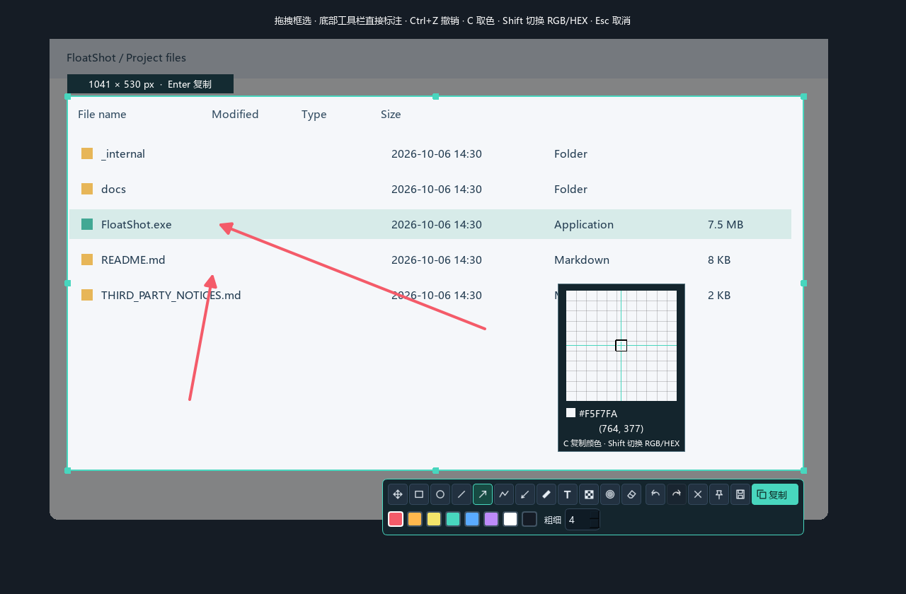
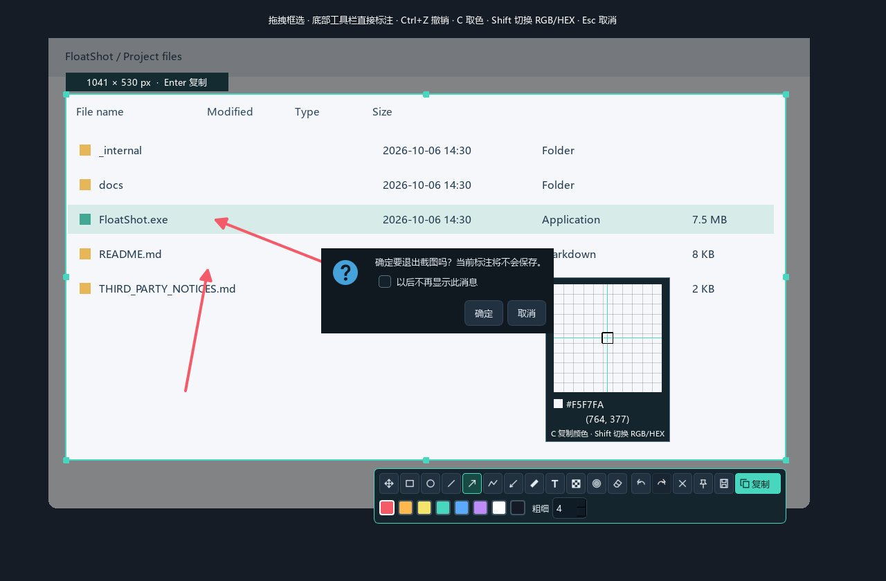

# 浮光 FloatShot v0.2.0 更新记录

日期：2026-10-06。

## 截图流程

框选后直接在桌面选区内标注，底部工具栏提供移动选区、矩形、椭圆、直线、箭头、折线、画笔、高亮、文字、马赛克、模糊、擦除、撤销、重做、保存、贴图和复制。

选择绘图工具时展开调色和粗细设置；文字工具提供字号设置，并在截图界面内输入文字。绘制及导出复用原图片编辑器的标注模型，输出保留选区原始分辨率；遮罩、工具栏、放大镜及控制点不进入图片。

选中后移动鼠标继续显示局部放大、坐标和颜色，包含已完成的标注。C 复制颜色并保留当前截图；Shift 在 RGB / HEX 间切换。工具栏自动定位到选区下方，空间不足时放到上方。

已有标注时按 Esc 或点击取消会提示“确定要退出截图吗？”，支持确定、取消和“以后不再显示此消息”。该选项持久保存，可在设置中重新开启。正在输入文字时，Esc 先取消本次文字输入；正在绘制折线时，Esc 先取消未完成的折线。

保存对话框取消后回到原选区并保留标注。选区调整保留标注，标注坐标与截图像素在高 DPI 下正确换算。

## 验证

自动化测试 **31 项通过**，覆盖选区内标注及高 DPI 导出、撤销／重做、内嵌文字、局部放大与颜色复制、退出确认及持久设置、取消保存后继续编辑、选区调整、工具栏定位，以及原截图、贴图、存储和编码流程。

Qt 界面预览使用合成桌面生成，并检查底部工具栏、标注、放大镜和退出提示的布局。测试机当前锁屏，真实桌面合成画面的显示验证仍待解锁后执行。

## 运行

从旧版托盘菜单“退出”关闭旧进程后，打开 `dist/FloatShot-0.2.0/FloatShot.exe`。分发包为 `dist/FloatShot-0.2.0-win-x64.zip`，解压后保留整个目录。
