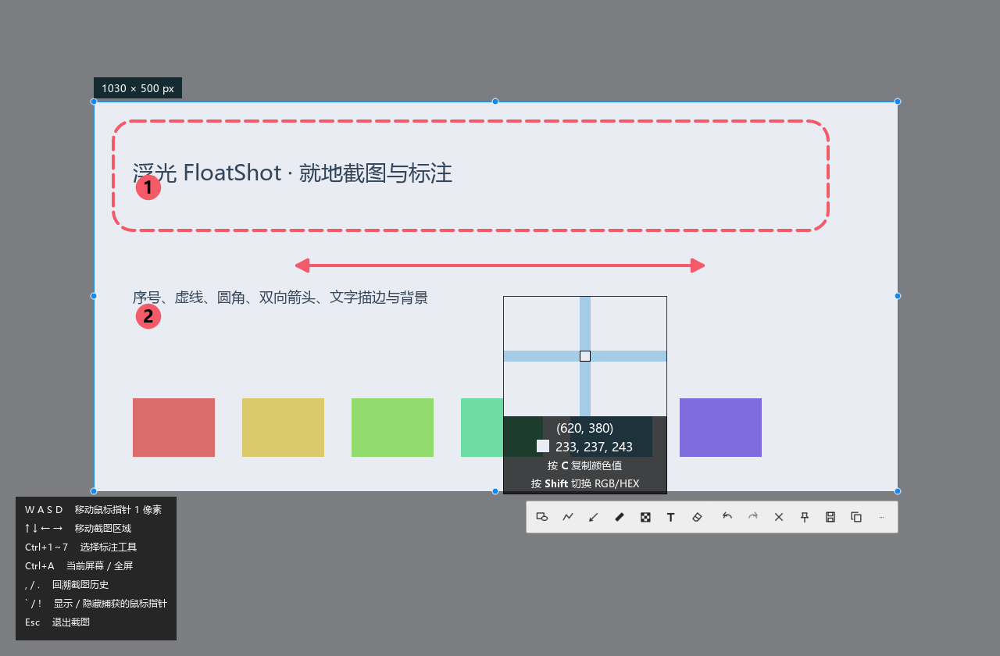

# v0.4.1 截图交互修复

交付日期：2026-10-07。本次修复用户反馈的五项截图问题。完整操作见 [功能与操作说明](Snipaste功能对齐-v0.4.1.md)。

## 本次变化

- 移动和缩放截图选区时，从冻结的桌面快照实时生成框内预览，不再将旧裁剪图拉伸到新选区。拖动中的标注预览随选区正确映射，松开时提交一次；撤销/重做历史不会在每次鼠标移动时重复变换。
- 标注控制点悬停显示对应的水平、垂直、斜向缩放箭头；旋转点显示旋转光标。悬停可移动的笔迹显示四方向箭头。标注控制点与外层选区控制点使用同一命中优先级，避免光标显示缩放而按下后开始画图。
- 中空矩形/椭圆的内部空白不再用于移动；边缘或笔画才可拖动。虚线的空白间隙也用于确认。普通截图和贴图只允许编辑最近一个尚未确认对象；点击空白（包括选区外空白）、开始下一笔或切换绘图工具即确认旧对象，移除控制点与编辑边框。确认后的对象不能重新选择，但仍可撤销/重做。子栏粗细、颜色等参数修改保留当前待确认对象。
- F1 不再同步等待 UI Automation 控件遍历；窗口控件识别在后台执行，迟到结果只应用到对应且仍可见的截图会话。截图工具栏延后到框选完成时创建，完整字体列表在展开下拉框时加载。工作台已隐藏时去掉原有 130 ms 合成等待；可见工作台仍等待退出屏幕合成，以避免把主窗口截入图片。用户配置的截图延时继续生效。
- 截图取色框按参考照片改为无网格、1 px 细边框、半透明黑色信息区。蓝色十字占一个放大像素的宽度，中心像素保留原色并使用细黑线框。坐标在颜色上方，C 和 Shift 提示分两行，键名加粗；截图初始使用 RGB，Shift 可切换 HEX。录屏选区保留原取色框，网格设置文案明确其适用范围。
- 贴图重启恢复时保留完成的标注显示，并将它们视为已确认；可以继续添加新标注。

## 响应速度

在本机 Windows 桌面、工作台已显示后收起、零截图延时下，三次“开始抓屏 → Qt 首帧绘制完成”分别为 **92.4 / 106.8 / 92.5 ms**。其中选区控件初始化为 **2.3 / 1.2 / 0.7 ms**；框选完成后创建工具栏为 **46.2 / 36.0 / 38.7 ms**。

旧流程测得同步控件检测使抓屏阶段达到约 396～546 ms，首次隐藏工具栏创建约 481 ms，此外还有固定 130 ms 等待。旧数据与新数据的初始化条件不同，不将它们当作严格同条件倍数对比。以上首帧数据不包含显示器刷新、系统热键排队或用户自行配置的截图延时。

测量工具：`tools/verify_capture_latency.py`。报告：`.test-artifacts/capture-v0.4.1/latency.json`；旧阶段报告保存在 `.test-artifacts/before-v0.4.1/latency.json`。测量不保存真实桌面内容。

另用 `--tray` 检查“主窗口从未显示”的首次调用，三次首帧为 **124.5 / 107.0 / 105.0 ms**，报告位于 `.test-artifacts/capture-v0.4.1-tray/latency.json`。

## 验证

- 84 项自动测试通过，新增 1×/2× 选区拖动中的实时预览、历史一致性、边缘拖动、空白确认、控制点光标、虚线间隙命中、取色框渲染、后台控件识别和合成等待回归测试。
- 解锁的 Windows 桌面合成检查通过：截图与录屏选区在拖拽中和松开后均显示正确范围、高亮、边框与遮罩，导出不包含编辑界面。
- 便携版进行原生/离屏启动、合成截图与贴图、OCR/扫码和 TLS 后端检查；结果保存在 `.test-artifacts/portable-v0.4.1-*`。
- `recorder.py` SHA256 为 `6a573099e509f6d1743a2b6c2a8c4d6d9c9d9962669f2df574639716db79449c`，与本次修改前一致。本次未重新进行真实声音或长时间录制。

预览使用合成画面：

## 运行位置

可执行文件：

    D:\UserFiles\Documents\ChatGPT\New project\dist\FloatShot-0.4.1\FloatShot.exe

便携包：

    D:\UserFiles\Documents\ChatGPT\New project\dist\FloatShot-0.4.1-win-x64.zip

操作说明：

    D:\UserFiles\Documents\ChatGPT\New project\docs\Snipaste功能对齐-v0.4.1.html

先从旧版托盘菜单退出，再运行新版；设置、历史和贴图继续读取原数据目录。便携版需保留整个文件夹及其中的 `_internal`。
