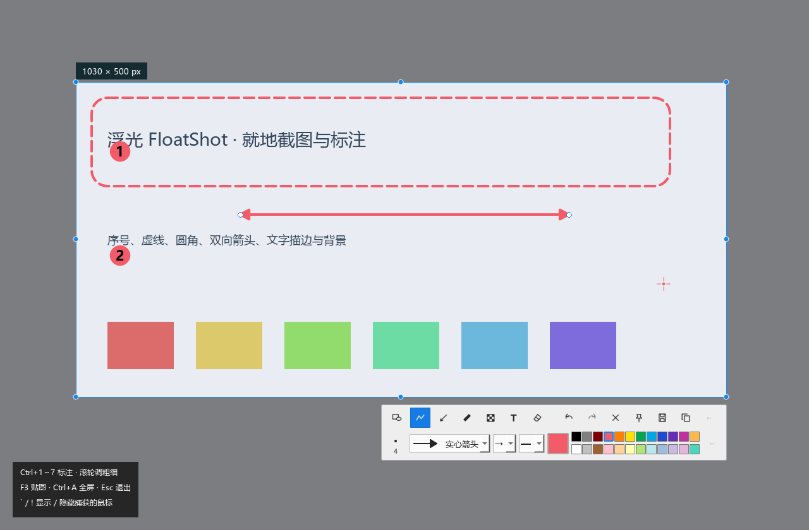

# v0.4.2 线段端点与截图 F3 贴图

交付日期：2026-10-09。根据用户补充的 Snipaste 操作，修正直线/箭头编辑方式及截图期间 F3 的行为。

## 本次变化

- 直线和箭头绘制完成后，只在实际起点、终点显示两个控制点，移除标注的矩形编辑框及方框缩放手柄。外层截图选区仍保留自己的边框与控制点。
- 拖动一个端点独立修改其位置，另一端保持固定；线段长度、方向和箭头位置随端点实时更新。按住 Shift 约束到 45° 方向。一次连续端点拖动对应一次撤销，可重做。
- 起终点悬停使用四方向箭头；拖动绘制笔迹仍可移动整个尚未确认的线段。沿用最近标注确认规则：点击空白或开始下一笔后，旧对象不可重新选择编辑。
- 截图期间按 F3，将当前选区及标注转成可移动的悬浮置顶贴图，结束截图。文字输入框中的内容会先提交；工具栏、控制点和取色框不会进入贴图。尚未选区时按 F3 不输出。
- 同时处理 Qt 窗口内 F3 和 Windows 全局贴图热键回调，避免全局热键先拦截后错误贴出剪贴板。非截图状态下，F3 继续执行原有剪贴板贴图/恢复功能。
- 截图与贴图共用端点编辑实现；录屏不增加上述截图 F3 操作，现有录屏流程继续沿用。

## 验证

- 103 项自动测试通过。新增 1×/2× 直线和箭头的两端拖动、固定另一端、实时预览、单次撤销/重做、反向线段、Shift 约束、回到原点、控制点渲染与导出隔离，以及贴图端点编辑检查。
- 截图 F3 测试覆盖窗口快捷键、文字输入状态、Windows WM_HOTKEY 回调路径、置顶贴图内容、截图结束、历史记录及空选区。测试中特意放入不同的剪贴板图片，确认输出来自当前截图。
- 便携版通过原生/离屏启动、合成截图/贴图、端点编辑、窗口内/全局回调贴图、OCR/扫码和 TLS 后端检查。报告保存在 `.test-artifacts/portable-v0.4.2-*`。
- Qt 渲染检查覆盖截图及录屏选区的拖拽中和松开后显示，图片内容为合成画面。当前 Windows 桌面锁定，本轮实际屏幕合成检查无法执行；`--render-only` 检查通过，但不代表已完成实屏复测。v0.4.1 的实屏检查记录见该版本更新文档。
- `recorder.py` SHA256 与 v0.4.1 相同：`6a573099e509f6d1743a2b6c2a8c4d6d9c9d9962669f2df574639716db79449c`。本次未重新进行真实声音或长时间录制。

## 运行位置

可执行文件：

    D:\UserFiles\Documents\ChatGPT\New project\dist\FloatShot-0.4.2\FloatShot.exe

便携包：

    D:\UserFiles\Documents\ChatGPT\New project\dist\FloatShot-0.4.2-win-x64.zip

操作说明：

    D:\UserFiles\Documents\ChatGPT\New project\docs\Snipaste功能对齐-v0.4.2.html

先通过旧版托盘菜单退出，再启动新版。便携版需保留整个文件夹及 `_internal`；原有设置、历史和贴图继续读取原数据目录。
