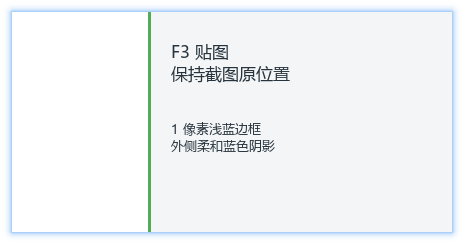

# v0.4.4 贴图边框对齐 Snipaste 参考图

交付日期：2026-10-09。按用户提供的 Snipaste 贴图照片调整桌面贴图边框。

## 本次变化

- 常态边框为 1 像素浅蓝线，颜色取自参考图 RGB(170, 207, 249)；外侧约 9 像素蓝色阴影逐渐变淡。移除深色粗框及焦点绿色边框，多选时使用略深蓝的细线标识。
- 阴影绘制在透明外侧区域，图像不缩小。F3、Ctrl+T、中键及截图工具栏贴图保持原截图位置和显示大小。
- 缩放、裁剪、取色、标注坐标和吸附按图像边缘计算；透明背景模式保留边框，同时让图像中的透明像素穿透。
- 普通复制、保存及工作区原图不包含窗口边框与阴影。“带边框 / 阴影保存”仍使用现有的单独输出功能。
- 增加工作区边距版本信息；读取旧版布局时迁移窗口坐标，恢复后图像位置不偏移。
- 录屏保持现有流程。

## 验证

- 119 项自动测试通过。新增边框像素颜色、阴影渐变和透明外侧、焦点样式、透明图像穿透、无边框导出及旧布局迁移检查；既有 F3 原位置、多 DPI、负坐标、标注和录屏回归测试通过。
- 本机两台 100% 缩放显示器上，Windows 窗口坐标和实际合成像素检查通过：图像位置及显示大小保留，边框与阴影颜色符合参考图。检查只采样合成画面。报告：`.test-artifacts/pin-position-v0.4.4/report.json`。
- 便携版启动、边框与透明阴影、原位置 F3 贴图、端点编辑、OCR/扫码和 TLS 后端专项检查结果见 `.test-artifacts/portable-v0.4.4-*`。
- `recorder.py` 与修改前一致，SHA256：`6a573099e509f6d1743a2b6c2a8c4d6d9c9d9962669f2df574639716db79449c`。本次未重新进行真实声音或长时间录制。

高 DPI 和负坐标测试使用合成屏幕；本机双屏实际显示检查为 100% 缩放，混合 DPI 实机效果仍待验收。

## 运行位置

可执行文件：

    D:\UserFiles\Documents\ChatGPT\New project\dist\FloatShot-0.4.4\FloatShot.exe

便携包：

    D:\UserFiles\Documents\ChatGPT\New project\dist\FloatShot-0.4.4-win-x64.zip

操作说明：

    D:\UserFiles\Documents\ChatGPT\New project\docs\Snipaste功能对齐-v0.4.4.html

先在旧版托盘菜单中退出，再启动新版。便携版需保留整个文件夹及 `_internal`；原有设置、历史和贴图继续读取原数据目录。
