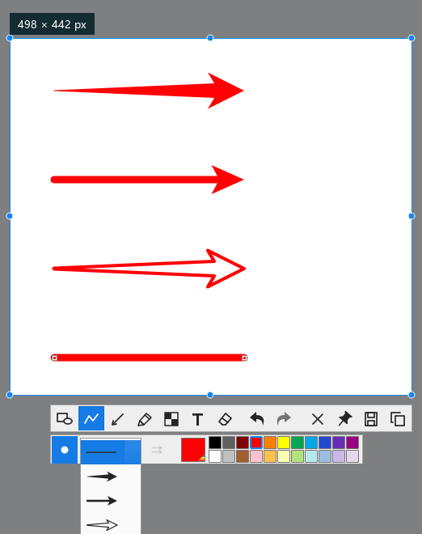

# v0.4.5 参考图箭头、工具栏与标注偏好

交付日期：2026-10-09。根据用户提供的四种标注及工具栏照片，并补充退出提示位置和参数记忆。

## 本次变化

- 线型下拉按参考图依次显示直线、渐宽实心箭头、等宽实心箭头和渐宽空心箭头，以图形预览选择。
- 渐宽箭头从细尾逐渐加宽；等宽箭头使用圆头杆身与实心箭头；空心箭头的杆身和头部均中空。截图预览、贴图、导出与命中检测使用相同轮廓。
- 直线和箭头显示两个小方形端点，保留独立端点修改、Shift 方向约束和撤销/重做。点击空白后确认，空心箭头内部空白不能用于移动对象。
- 工具栏采用独立的浅色主栏和紧凑参数栏，蓝色选中态，更新记号笔、马赛克、撤销/重做和贴图图标、分隔线、蓝底白色粗细圆点、箭头方向按钮、调色标记及两排色板。
- 折线、其他原有箭头样式、高级参数和色板管理通过 F10 或工具栏右键打开。虚线/点线参数继续保留。
- Esc 退出提示在当前截图选区的全局中心显示，适用于副屏；取消退出后继续保留选区与标注。
- 首次默认颜色为 RGB(255, 0, 4)。颜色沿用最近一次选择，包括透明度，跨工具和样式继续使用；粗细、线型、方向、字体、字号和其他参数分别记忆。选择后保存到用户配置，取消、新建截图、贴图标注和重启都可以恢复。
- 修复贴图首次进入标注时，默认参数覆盖已保存箭头样式的问题。已有保存颜色继续读取，不重置用户选择。
- v0.4.4 浅蓝贴图边框和阴影、F3 保留原位置及大小继续沿用；录屏流程保持现有。

- 设置“常规与存储”增加“显示操作通知（截图、贴图、保存等）”，默认关闭。开启后才显示操作通知；关闭后不发送托盘通知或更新操作提示。

## 验证

- 134 项自动测试通过，覆盖箭头渐宽/等宽/中空、半透明交接、虚线空隙命中、两端点编辑、四项图形下拉、当前箭头样式切换、参数保存与新建截图/贴图/配置重读、通知默认关闭及开关持久化、退出提示居中及既有截图/贴图/录屏回归。
- 本机两台 100% 缩放显示器上，实际检查退出提示框在各自截图选区中心；F3 图像原位置及大小、贴图边框阴影和 Windows 窗口坐标检查通过。报告：`.test-artifacts/pin-position-v0.4.5/report.json`。仅采样合成画面。
- 便携版检查包含原生/离屏启动、四种线型、参数记忆、RGB 初值、退出提示、F3 原位置、贴图边框、端点编辑、OCR/扫码和 TLS 后端。报告：`.test-artifacts/portable-v0.4.5-*`。
- `recorder.py` 与修改前一致，SHA256：`6a573099e509f6d1743a2b6c2a8c4d6d9c9d9962669f2df574639716db79449c`。本次未重新进行真实声音或长时间录制。

高 DPI 和负坐标覆盖为合成测试；本机显示器均为 100% 缩放，混合 DPI 实机效果仍待验收。

## 运行位置

可执行文件：

    D:\UserFiles\Documents\ChatGPT\New project\dist\FloatShot-0.4.5\FloatShot.exe

便携包：

    D:\UserFiles\Documents\ChatGPT\New project\dist\FloatShot-0.4.5-win-x64.zip

操作说明：

    D:\UserFiles\Documents\ChatGPT\New project\docs\Snipaste功能对齐-v0.4.5.html

先通过旧版托盘菜单退出，再运行新版。便携版保留整个文件夹及 `_internal`；继续读取原用户设置、历史和贴图。
