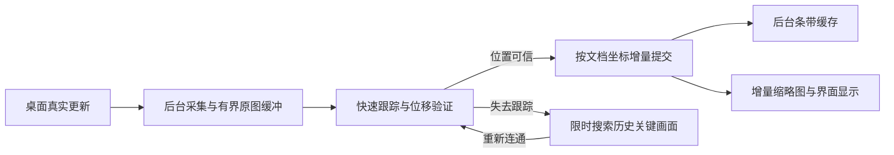

# 长截图设计：流畅性与性能

日期：2026-10-24。当前可用基线为 Astra 首版 v0.5.27，产品代码对应 `199d1ea`；v0.5.28 留作回归对照。本次仅完善设计，未修改算法、构建安装包或切换正在使用的程序。

## 设计结论

采用“快速连续跟踪 + 有限成本的重定位 + 独立的增量成图”。正常滚动只处理最近画面中的少量有效特征；局部动画作为异常运动处理；确实失去跟踪时才搜索历史关键画面。所有路径都有时间和内存预算。

流畅性以“页面出现新内容到预览确认追加的延迟”衡量。高采样次数、界面动画或大量拒绝画面均不能替代这项指标。正确性仍是基础：连续区间不漏、不重、不乱覆盖，证据不足时保留已确认内容。

不预设九宫格、固定票数、动画形状或某种颜色。研究和原型可以调整算法，但需要共同通过本文的体验与资源验收。

## 当前问题的依据

以下来自本机已有会话日志，不是新方案的性能结果；不能据此把所有拒绝归因于动画。

| 记录 | 已有现象 | 对设计的意义 |
| --- | --- | --- |
| v0.5.27，2026-10-24 11:20 会话 | 处理 965 帧，拒绝 414 帧，平均匹配约 5.07ms，最大排队约 2.85ms | 算得快但频繁拒绝，仍然会出现预览断续。需要提升有效跟踪能力。 |
| v0.5.28，2026-10-23 13:13 会话 | 平均匹配约 165ms，最大排队约 5.96 秒 | 扩大搜索和验证会拖垮响应，需要限制最坏处理成本。 |
| 当前 V2 代码 | 候选验证把所有差异包成一个矩形，仅允许一块很小的局部变化 | 多个分散的加载圈可能被当作一片大变化而拒绝。 |
| 当前管线 | 匹配中同步保存原图条带；更新预览时复制累计条带列表；完成时在界面线程等待后台排空 | 磁盘、长图长度和积压可能影响交互，必须单独计时并拆开。 |

当前 `sample_poll_hz` 包含重复画面的采样轮询，不能直接解释为真实新画面帧率。后续分别统计桌面更新、成功读回、有效位移、确认追加和界面显示。

## 成熟方法的选择

| 参考方法 | 采用方式 | 使用边界 |
| --- | --- | --- |
| 金字塔 Lucas–Kanade 稀疏光流 | 连续跟踪文字和纹理特征，用往返跟踪误差剔除不可靠点 | 大幅跳动、重复内容和少纹理时需要重定位，不能单独决定拼接。 |
| RANSAC／一维鲁棒共识 | 在局部匹配中寻找共同纵向位移，限制每个局部区域的权重 | 同一密集动画不能靠大量特征点压过正文。只拟合滚动需要的平移。 |
| 带掩码的归一化相关 | 对候选位置做独立验证，排除已经有依据的局部重绘 | 掩码要参与正确的归一化，不能把变化处涂黑后直接做普通相关。 |
| DXGI 移动区和脏区元数据 | 减少无变化读回，并为位移提供额外候选 | 浏览器可能整块重绘，元数据也可能合并或为空；不能当作目标页面的精确滚动距离。 |
| ShareX 的滚动截图实现 | 参考其采集、滚动控制和结果交付的衔接 | 已查阅实现以受控滚动、等待和行匹配为主，不能直接证明快速手动滚动与动画场景的能力。 |

主线先用稀疏跟踪加局部相关验证；全图 FFT 配准和较重的特征描述子保留为重定位实验，不放进每帧常规路径。不引入 OCR、学习模型或服务器。

## 定位与动态内容

1. 从缩小后的灰度／梯度图中选择少量、有区分度且位置分散的特征。空白不投票，重复装饰和单一区域的点数受限。工作图保持坐标映射，最终输出始终使用原始像素。
2. 连续帧使用光流和近期位移提出候选，经往返误差与纵向运动共识过滤。滚轮、按键和 DXGI 元数据帮助缩小候选范围，位置仍由画面确认。
3. 在没有用于拟合的局部上下文中独立验证候选；核对原始分辨率的小块，细化到输出行坐标。颜色和轻微重绘可容忍，文字内容差异不能被平均值掩盖。
4. 对齐之后观察仍然变化的局部区域，分别维护动画／重绘置信度。加载圈、表情和悬停颜色可以同时存在。区域有独立边界和有效期，不用包住多个对象的大矩形，不根据“这次不匹配”就任意扩大掩码。
5. 定位同时检查有效证据的数量、分布和唯一性。重复消息中真正有区别的小字不能被全部屏蔽；两个位置同样可信时，等待后续证据。页面缩放、图片撑高或插入内容造成的版式变化单独识别。
6. 连续跟踪使用最近可信画面，已导出的长图像素作为另一份冻结结果。允许更新跟踪参考中的动画相位，不需要为匹配而改写已拼长图。只有可信位置才能更新锚点与追加内容。

近期位置与关键画面保持文档坐标关系，周期性校验，避免逐帧位移累加造成漂移。平滑滚动的亚像素位置保留到定位阶段，原始图像在确认坐标后取行，不反复缩放或累加舍入误差。

失去跟踪后，先搜索最近可能经过的关键画面，再用紧凑索引查历史候选；每次工作受预算约束，可跨调度轮次继续。快速路径不逐帧扫描整张长图，历史搜索不占住界面线程。找到远处的相似位置仍需证明与已截区间连续，不能跨过缺失段直接追加。

静止时只有加载圈旋转，应维持原位置并更新局部状态，不反复启动全图重定位。若页面连续出现新的可信内容，应及时提交，不要求整个页面先停止动画或滚动。

成图采用冻结前缀与有界的接缝尾段。位置确认后预览即可增长；未冻结尾段允许在相同文档坐标内选择更合适的像素来源，范围与高度不随动画改变。接缝优先选在稳定内容处，绕开动态区域，同一小对象尽量由同一帧完整提供。只有这个尾段可暂缓冻结，不能为了动画而覆盖前面的大段消息；向上补图按对称规则处理。有限范围内仍找不到可靠接缝时暂缓该段提交并说明原因，结束时检查尾段来源与连续性。

## 采集、调度与预览

- **采集**：优先使用 DXGI 真实桌面更新；鼠标单独更新、超时和正文更新分开处理。首个参考必须来自准备完成的真实桌面帧。复用读回资源，元数据只处理选区相关部分；读回阻塞显著时再验证双缓冲收益，避免无依据地增加一帧延迟。DXGI 不可用时保留 GDI 路径。
- **Windows 10**：最低兼容范围仍是项目已有的 Windows 10 1809。1809 不能依赖较新系统的捕获排除；边框、预览和控制条尽量放在选区外，选区保持实际挖孔，空间不足时调整或收起预览。避免把每次隐藏界面、同步等待桌面刷新作为常规采样步骤。
- **有界缓冲**：原图池按真实字节数计费，特征图、GPU 资源和写盘待处理数据也计入预算。保存能够连接前后画面的必要中间帧。无法及时处理时先减少特征数量、非必要验证与界面更新，再在验证有替代重叠后合并冗余帧；不能无条件丢到只剩最新帧。
- **限时处理**：跟踪、恢复搜索、写盘分别有预算和可取消点。过时但仍是唯一连接的帧继续保留；若资源不足以保持连接，明确暂停扩展，记录原因，保留正确结果。不能一边累积数秒旧帧，一边显示正在实时截取。
- **增量存储**：新增原始像素先进入有界的不可变块，再由后台按块落盘。连续小条带聚合，避免每增加一行就创建文件；落盘失败或持续跟不上时及时反馈。已确认但未落盘的数据保持在预算内，完成输出前检查全部依赖。
- **增量预览**：只发布新增缩略块、范围变化和视口位置，不逐帧复制累计条带列表。缩略图分级合并，绘制成本由预览尺寸和可见层级约束；位置变化不触发整套工具栏布局和所有原图缩放。界面可按 30Hz 合并更新，定位与采集独立运行。
- **完成与取消**：界面立即响应，后台停止采集、处理必要的连续依赖并封存结果，通过事件通知完成；不在界面线程等待长队列或磁盘。存在未接上的内容时清楚标出最终确认范围。取消信号可在有限工作片内生效，后台资源清理由受管理的任务完成。

正常跟踪的计算量应主要与当前选区和有效特征数有关。原图存储随长度增长；活跃关键画面、缓存和预览层级受预算管理，不能随已截高度增加而让每帧匹配持续变慢。

## 原型的性能目标

以下是待验证的目标，不是当前版本实测承诺。基准测试先登记设备、功耗状态、系统版本和采集后端；目标基准机为 i5-8250U 同级四核笔记本、8GB 内存、集显、SSD。具备真实设备后验证，模拟限核不能替代旧机实测。

标准负载为 60Hz 桌面、1000×800 实际像素选区、普通网页／聊天正文、正常及快速手动滚动；另测 1920×1080 和 4K 选区的退化情况。P95 表示 95% 样本不超过该值。

| 指标 | 标准负载目标 | 统计边界 |
| --- | --- | --- |
| 快速定位与验证 | P95 ≤ 8ms，P99 ≤ 16ms | 包括特征更新、候选验证；恢复路径另报，不混进平均值。 |
| 新内容出现至确认预览 | P95 ≤ 100ms，P99 ≤ 200ms | 包含采集、排队、计算、提交和界面等待。按真值标记有足够重叠与稳定证据的真实延伸，算法自身未接纳仍计为延迟／停顿。 |
| 连续延伸的停顿 | 正常有新内容时，超过 250ms 的未追加停顿需逐次归因 | 单独排除触底、静止、真实缺口和达到输出上限，不能排除算法自身失败。 |
| 界面更新工作 | P95 ≤ 4ms；停止／取消在 100ms 内得到可见响应 | 不用等待导出结束才响应点击。 |
| 正常运行 CPU | 会话平均不超过一个逻辑核心的计算量 | 汇总本功能的全部线程；即 CPU 时间／墙钟时间 ≤ 1，不按多核占比美化。动画静止场景另测。 |
| 活跃内存增量 | 标准负载 ≤ 64MiB；1080p ≤ 128MiB | 相对进入长截图前测峰值，含图像、索引、读回及待写缓存；4K 单列预算与结果。 |
| 长时间滚动 | 相同当前视口负载下，末段定位 P95 比首段增加不超过 20% | 标准宽度至少测到 30000 像素高，并记录 CPU、内存和缓存文件数量。 |

采集有效频率和预览刷新率单独报告，以端到端延迟判断是否流畅，不用线程轮询次数替代。超过目标时先调整分析分辨率、特征预算、缓存和调度，不通过降低原图清晰度或放宽错误拼接来达标。

当前 6400 万像素／10 万像素高度的导出保护先保留，进入及临近边界时显示实际范围。输出整图的内存和时间单独测量，不算入滚动阶段预算：6400 万像素的 32 位整图仅像素就约 244MiB，剪贴板可能还需要额外副本。保存研究按块编码；复制、贴图和标注按接口需要在后台准备整图，显式检查可用资源。

## 验证与交付顺序

1. **记录真实基线**：给各阶段加单调时间戳，分别记录采集、GPU 读回、排队、跟踪、恢复、写盘、界面展示及停止耗时；记录有效帧、拒绝原因、历史搜索次数、连接帧保留、确认范围和资源峰值。诊断输出默认不保存用户桌面图片。
2. **先验证算法收益**：用同一批有坐标真值的离线序列对比 v0.5.27 和新原型。覆盖多处加载圈、动态表情、悬停变色、静态文字、重复消息、大片留白、亚像素滚动、快速往返、故意移除中间帧及版式改变。保留未参与调参的页面和动画样式。
3. **再验证整条链路**：用独立页面产生已知滚动轨迹，通过真实桌面采集检查端到端表现；页面坐标只用于验收，不能输入算法。桌面采集失败、CPU 压力、慢写盘、临近长度上限和取消也在此验证。
4. **扩大负载**：至少在 Windows 10 1809、较新 Windows 10 和 Windows 11、常见 DPI 下验证。对标准选区、1080p、大选区和长时间滚动分别给出资源与延迟分布；缺少的实际设备明确列为未验证。
5. **通过后再做独立试验包**：保留当前 v0.5.27 程序和安装包，试验产物使用独立版本及明确入口。用同页同轨迹 A/B 对比实际预览，再决定接入范围，不把方案目标写成已经完成的能力。

每个可通过场景同时报告连续覆盖率、误拼、漏行、重行、暂停次数及耗时，不能仅报告“已接纳帧中的正确率”。静态场景核对完整导出的原始像素；动态场景按像素来源与文档坐标检查连续性，检查接缝是否截断对象。故意缺口和歧义的测试必须保留，固定回放集要求无错误接纳。

## 实现范围与依赖

主体继续使用 C++20／Qt，本地 CPU 负责定位，DXGI 利用系统现有的桌面图像。算法和缓存按进入长截图时初始化、退出时释放；普通启动、F1 和 F3 不初始化新增模块。

仓库的 OCR 子程序已有 OpenCV 4.11 `core`／`imgproc` 静态依赖，主程序尚未因此具备光流模块。原型应核对现有 SDK，只增加必要的图像处理／跟踪能力；一维位移共识可独立实现，不为滚动引入完整 `opencv_world`、模型或 Python。若链接方式影响主程序常驻占用，再采用按需加载的原生模块；不为拆模块增加逐帧跨进程原图复制。

允许替换当前 V2 的定位和调度实现，保留既有选区入口、预览交互、输出接口以及原始像素要求。旧方案与版本记录作为历史依据，具体九宫格、像素阈值、特征数量和线程个数不作为固定需求。

## 已查阅资料

- Microsoft：[Desktop Duplication API](https://learn.microsoft.com/en-us/windows/win32/direct3ddxgi/desktop-dup-api)，桌面更新、移动区、脏区和鼠标更新的含义。
- OpenCV：[光流 API 定义与说明](https://github.com/opencv/opencv/blob/4.x/modules/video/include/opencv2/video/tracking.hpp)、[往返跟踪示例](https://github.com/opencv/opencv/blob/4.x/samples/python/lk_track.py)。示例仅用于核对方法，产品使用 C++ API。
- OpenCV：[鲁棒变换估计说明](https://github.com/opencv/opencv/blob/4.x/modules/calib3d/include/opencv2/calib3d.hpp)，用于参考异常匹配剔除；产品不需要自由仿射或透视变换。
- scikit-image：[带掩码配准 API](https://scikit-image.org/docs/stable/api/skimage.registration.html#skimage.registration.phase_cross_correlation)、[Masked Normalized Cross-Correlation 示例](https://scikit-image.org/docs/stable/auto_examples/registration/plot_masked_register_translation.html)，包含 Padfield 方法参考。作为算法资料，不引入 Python 运行时。
- ShareX：[ScrollingCaptureManager](https://github.com/ShareX/ShareX/blob/master/ShareX.ScreenCaptureLib/ScrollingCaptureManager.cs)，查阅受控采集、行匹配及结果合成路径，未复制其源码。

资料查阅于 2026-10-24。成熟算法的存在说明方案有依据，具体成功率、耗时、内存与设备覆盖仍由上述原型实测确定。
