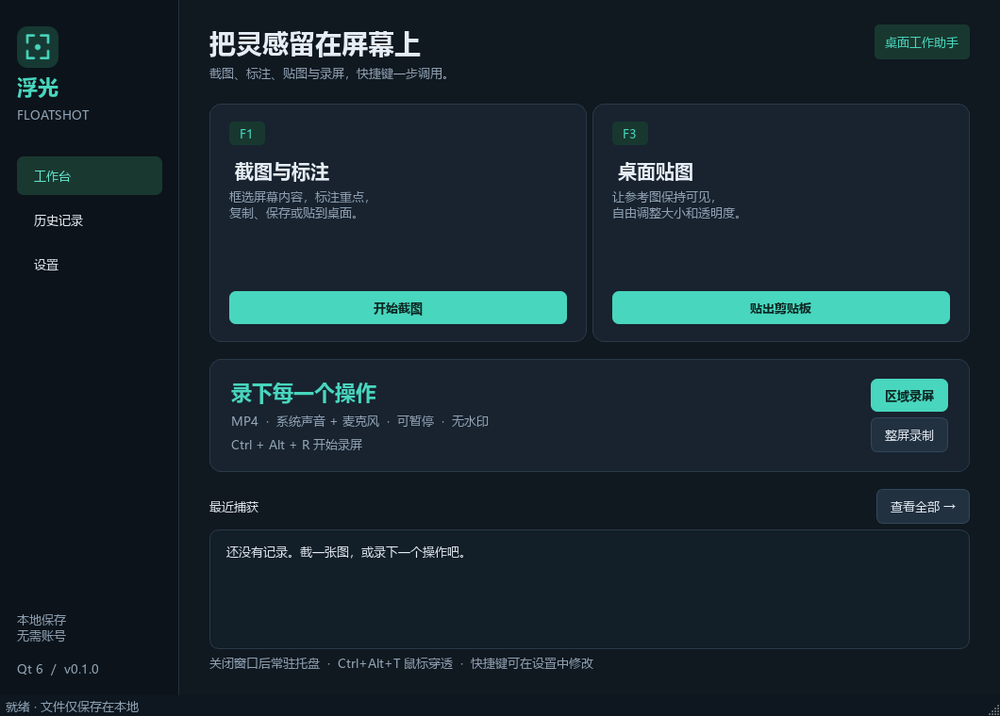
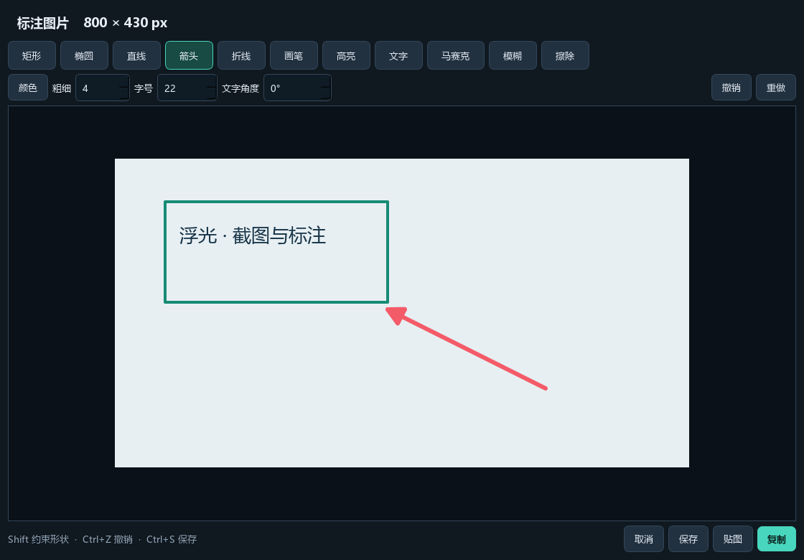

# 浮光 FloatShot v0.1.0 首版交付记录

日期：2026-10-06。技术方案为 Qt 6.10.3 Widgets / 官方 Python 绑定 PySide6，Windows x64。录屏使用 FFmpeg 7.1 的 H.264/AAC 编码，音频通过 WASAPI 采集。

本次交付是可运行的首版，已完成截图、标注、桌面贴图和基础录屏的主要流程。原功能规划中的专业版增强项继续作为后续迭代清单；本稿不表示全部 Snipaste 功能已达到相同精度或兼容范围。

## 交付文件

- `dist/FloatShot/FloatShot.exe`：便携应用入口，需要保留同目录的 `_internal`。
- `dist/FloatShot-0.1.0-win-x64.zip`：整个便携目录的压缩包。
- [README](../README.md)：操作、快捷键、数据目录、开发和构建方法。
- [功能规划](截图贴图录屏工具-功能文档-v0.1.md)：原始功能清单和优先级。
- [第三方组件说明](../THIRD_PARTY_NOTICES.md)：依赖、版本、许可及来源。
- `floatshot/`、`tests/`、`tools/`、`FloatShot.spec`：保留源代码、验证及打包脚本。

## 实现范围

| 模块 | 本次已实现 | 后续增强 |
| --- | --- | --- |
| 截图 | 矩形选区、窗口/基础 Win32 子控件检测、多屏裁切、混合 DPI、放大镜、HEX 取色、逻辑坐标微调、上次选区、历史回放 | 更全面的 UI Automation 控件检测、物理像素级细化、尺寸预设、圆角、延时 |
| 标注 | 矩形、椭圆、直线、折线、箭头、画笔、高亮、文本/角度、马赛克、模糊、擦除、撤销/重做 | 已完成对象的二次编辑、序号、放大镜标注、编辑项目 |
| 输出 | 复制、PNG/JPEG、快速保存、自动保存开关；JPEG 透明区域填白 | WebP、边框/阴影、外部命令和系统分享 |
| 贴图 | 图片/图片文件/文字/HEX 颜色卡片、拖动、缩放、旋转、镜像、透明度、穿透、关闭/恢复/销毁、重启布局恢复 | 分组、多选、Solo、裁剪、虚拟桌面、网页图片 |
| 录屏 | 区域/整屏、15/30 fps、最高 1080p、指针、系统声音、麦克风、独立静音、倒计时、暂停、MP4、异常片段保留 | 窗口目标、GIF、裁剪、录制中标注、摄像头、4K/60 fps |
| 管理 | 主窗口、托盘、快捷键与冲突提示、可选开机启动、历史缓存上限、视频预览/文件复制/另存 | 搜索筛选、自动更新、云端能力 |

## 验证结果

自动化测试覆盖下列行为：

本次最终自动化测试结果为 **19 项通过**；便携 EXE 的独立启动、1080p/30 fps 录制、WASAPI 音频、编码与 Qt 预览检查通过。

- 负坐标和混合 DPI 的截图裁切，以及鼠标选区、键盘移动和输出。
- 标注绘制、马赛克、模糊、擦除、撤销和重做。
- 贴图隐藏、关闭恢复、销毁、布局及透明度恢复。
- 历史清理不删除用户另存文件，JPEG 透明区域处理。
- 工作台、标注窗口渲染与录制控制条按钮信号。
- 暂停时钟、停止时钟、实际 H.264 编码、双音轨混音及解码。
- 采集设备中断后，已录片段仍生成可播放 MP4。

Windows 本机验证已覆盖两台 1920×1080 显示器的识别、真实屏幕截图、全尺寸 1920×1080/30 fps 的短录制、原生指针、WASAPI 系统声音、暂停/继续、AAC 音轨、MP4 解码与 Qt 预览播放。该短录制的有效时长约 3.43 秒，主动暂停 0.5 秒未进入成片。

本机没有可用的物理麦克风，因此麦克风设备实录没有验收；双音源合成使用两条模拟音轨验证。30 分钟录制、物理像素微调、完整控件检测和不同硬件/Windows 版本的兼容验收仍待进行。

## 界面预览

## 后续建议

先试用首版截图、贴图及系统声音录屏，确认快捷键、输出目录和日常流程。下一批优先加入 OCR/扫码、贴图裁剪与分组、标注二次编辑、窗口录屏及 GIF/视频首尾裁剪。
